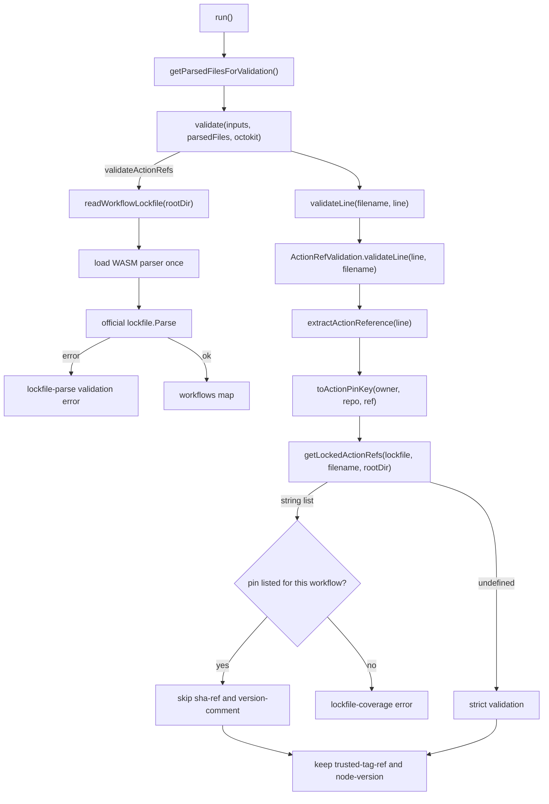

# Design: Accept workflow dependency lockfiles in gha-workflow-validator

> **Sequencing:** the AST-based extractor in
> `changes/gha-workflow-validator-parser/` lands first. After it, the
> `extractActionReference(line)` step below is a `UseReference` lookup keyed by
> filename and line. The lockfile rules and coverage logic are unchanged.

## Context

Paths below are relative to `actions/gha-workflow-validator/` unless noted.

- The validator is line-oriented. `src/parse-files.ts` returns
  `ParsedFile { filename, lines }`. `src/validations/validate.ts` loops files
  and lines and calls every `ValidationCheck.validateLine(line)`. The
  `ActionRefValidation` check extracts `uses:` references and applies four
  checks: trusted actions should use tags, untrusted actions need a SHA,
  untrusted actions need a version comment, and actions should not need an old
  node version.
- `ValidationCheck.validateLine` has no file context. Onboarding is per
  workflow, so the check needs the filename.
- `RunInputs.rootDir` points at the checkout. The lockfile is
  `.github/workflows/actions.lock`. The workflow globs only match `*.yml` and
  `*.yaml`, so the lockfile is never parsed as a workflow.
- GitHub publishes the authoritative parser at
  `github.com/github/actions-lockfile/go/pkg/lockfile`. `Parse` validates the
  whole file, including schema version, required fields, commit format, pin
  grammar, workflow path safety, and `uses` cycles. `LookupWorkflow` returns a
  workflow's pins and whether the workflow is onboarded. `ParsePin`
  canonicalizes `OWNER/REPO@REF`: owner and repo are lowercased, the ref
  preserves case, and sub-action paths are rejected because pins are
  repo-scoped.
- Pin keys do not include sub-action paths. A workflow using
  `actions/cache/save@v4` must match the pin `actions/cache@v4`.
- `github/gh-actions-lock` builds the official CLI. `--verify` performs the full
  check, including network-backed provenance. `--verify-local` is an offline
  coverage check. Both are read-only and exit non-zero on findings.
- The action bundles to `dist/index.js` with esbuild and the bundle is
  committed. Node 24 provides `WebAssembly`, so the action can run a Go WASM
  module without a native binary.
- `src/output.ts` renders messages by type and severity, so new message types
  need no output change.

## Approach



**Go bridge.** New `wasm/` module pinned to
`github.com/github/actions-lockfile/go v0.0.6`:

```go
func main() {
    js.Global().Set("parseLockfile", js.FuncOf(parseLockfile))
    js.Global().Set("parsePin", js.FuncOf(parsePin))
    select {}
}
```

`parseLockfile(contents)` calls `lockfile.Parse`. It returns JSON with `ok`,
`version`, and `workflows`, or `ok: false` with `error`, `line`, `column`, and
`futureVersion`. `parsePin(value)` calls `lockfile.ParsePin` and returns the
canonical key. The Go module is a separate build unit so the official module and
its `yaml.v3` dependency stay out of the TypeScript dependency graph.

**Build.** `scripts/build-wasm.sh` runs:

```sh
GOOS=js GOARCH=wasm go build -trimpath -ldflags="-s -w" -o dist/lockfile.wasm .
cp "$(go env GOROOT)/lib/wasm/wasm_exec.js" dist/wasm_exec.js
```

The `build:wasm` nx target owns both artifacts. `build` and `test` depend on it.
The wasm is about 5.7 MB raw and 1.6 MB gzipped; git stores it compressed. The
action checkout grows, but the review surface is the small Go bridge.

**TypeScript adapter.** `src/lockfile.ts` becomes a thin loader:

```ts
interface WorkflowLockfile {
  version?: string;
  workflows: Record<string, string[]>;
}
function readWorkflowLockfile(rootDir: string): Promise<LockfileReadResult>;
function getLockedActionRefs(
  lockfile,
  filename,
  rootDir?,
): string[] | undefined;
function toActionPinKey(owner: string, repo: string, ref: string): string;
```

The WASM runtime is started once and memoized. Artifact lookup checks
`__dirname` first (the bundled action), then `../dist` (Vitest from `src/`),
then `<cwd>/dist`. A missing artifact is a hard error with a message to rebuild.

`readWorkflowLockfile` checks the file size before parsing, calls
`parseLockfile`, and returns either the parsed workflows map or a
`LockfileParseError`. It does not fall back silently: a missing file is normal,
but an invalid file is a validation error.

**Pin canonicalization.** `toActionPinKey` lowercases owner and repo, keeps the
ref as written, and ignores the sub-action path. This matches `ParsePin` and
fixes the current false negative for actions like `actions/cache/save@v4`.
`validateLockfileCoverage` builds this key and requires an exact match in the
workflow's transitive pin list.

**Validation seam.**

- `ValidationCheck.validateLine` keeps the optional `filename`.
- `validate.ts` reads the lockfile once per run when `validateActionRefs` is on.
  It passes the lockfile and `rootDir` into `ActionRefValidation`.
- If the lockfile is invalid, `validate()` prepends a `FileValidationResult` for
  `.github/workflows/actions.lock` with a `lockfile-parse` error at the reported
  line. The workflow validators still run with strict rules, so the action fails
  once with a precise annotation.
- `run()` no longer exits early when the changeset has no workflow files. That
  lets a PR that only edits the lockfile report a parse error.
- When a workflow is onboarded, `validateShaRef` and
  `validateVersionCommentExists` are skipped. `validateTrustedActionTagRef` and
  `validateNodeActionVersion` still run.
- Reusable workflow calls stay skipped. The official docs say a lockfile does
  not pin `jobs.<job_id>.uses`.
- Local `./` and `$/` references stay skipped.

**Official CLI gate.** Add `workflows/verify-workflow-lockfile/`, a reusable
workflow that pins the extension and runs the official command:

```yaml
- run:
    gh extension install github/gh-actions-lock --pin "$GH_ACTIONS_LOCK_VERSION"
- run: gh actions-lock --verify
```

It accepts `mode: verify|verify-local` and an optional github.com token secret
for GHE.com callers. The line validator does not invoke the CLI.

**Rejected.**

- A hand-written YAML reader. It duplicates the authoritative parser and already
  drifted on sub-action pins and version handling.
- CLI-only validation. It gives file-level findings with no line numbers, adds a
  runtime install, and cannot replace the action's per-line decision.
- Running the CLI inside the action. It adds network, token, `gh`, and extension
  installation to every line validator run.
- Reading the lockfile from the GitHub API. The validator already trusts the
  checkout for existing workflows.

## Verification

- Go bridge: build the WASM, parse the sample lockfile, and assert the workflows
  map. Assert a malformed file returns a positioned error, and a path-traversal
  key is rejected. Assert `parsePin` drops a sub-action path and lowercases
  owner/repo.
- TypeScript loader: missing file returns no error; valid fixture loads; invalid
  fixture returns a `lockfile-parse` error; `toActionPinKey` canonicalizes
  correctly; `normalizeWorkflowPath` handles `./`, backslashes, and absolute
  paths.
- Validator: tag reference accepted on an onboarded workflow; SHA without a
  comment accepted; trusted action accepted; `./` filename accepted; missing pin
  errors; non-onboarded workflow still errors on a tag; a sub-action reference
  matches its repo-scoped pin.
- Wiring: `validate()` with a fixture checkout accepts the tag for the onboarded
  workflow, rejects the same tag for a different workflow, and prepends a
  lockfile error for a malformed lockfile.
- Reusable workflow: `pnpm workflows:check` passes and actionlint accepts the
  new workflow. The workflow is manually checked against a repo with a valid and
  an invalid lockfile.
- Run the project's test, build, and Prettier checks.

## Risks

- **The WASM artifact is large.** About 5.7 MB raw. Git compresses it to about
  1.6 MB, and the action download is compressed, but checkout size grows. If
  that is unacceptable, fall back to schema validation in TypeScript.
- **The build needs Go.** The action build now requires a Go toolchain with
  `GOOS=js`. CI already uses Go, but local builds and the pre-commit hook need
  it too. The build script fails with a clear message when `go` is missing.
- **The Go dependency can drift.** The module is pinned and reviewed like any
  other dependency. Upgrades are a changeset and a rebuilt wasm.
- **The checkout can be stale.** The lockfile is read from `rootDir`, not the PR
  head API. The action already reads existing workflows from that checkout.
- **The parser rejects a valid file.** That fails the action loudly on the
  lockfile instead of silently relaxing. The fix is to upgrade the pinned module
  or regenerate the lockfile.
- **The CLI gate has its own failure modes.** Rate limits, GHE.com tokens, and
  extension installs. It runs as a separate job so those failures do not take
  down the line validator.
- **Action definitions remain strict.** The lockfile maps workflows, not
  `action.yml` files, so composite actions still need SHA pins. That is
  unchanged.

## TODO

Effort: hard (official parser bridge, Go/WASM build, validation changes, tests,
and a new reusable workflow)

### Phase 1: Build the official parser bridge

- [ ] Add `wasm/go.mod`, `wasm/go.sum`, and `wasm/main.go` pinned to
      `github.com/github/actions-lockfile/go`. Expose `parseLockfile` and
      `parsePin`, returning JSON with positioned errors.
- [ ] Add `scripts/build-wasm.sh` and the `build:wasm` nx target, with `build`
      and `test` depending on it. Copy `wasm_exec.js` and build
      `dist/lockfile.wasm`.
- [ ] Replace `src/lockfile.ts` with the WASM loader, size check, path
      normalization, and canonical pin helper. Add unit tests for valid,
      missing, malformed, and traversal inputs.

### Phase 2: Use official pins in validation

- [ ] Make `readWorkflowLockfile` async, load it once in `validate()`, and
      prepend a `lockfile-parse` result for invalid files. Remove the
      no-workflow early exit so a lockfile-only PR still reports parse errors.
- [ ] Update `validateLockfileCoverage` to use the canonical repo-scoped pin
      key, and add tests for sub-action paths, trusted refs, `./` names, missing
      pins, and non-onboarded workflows. Docs: update the action README.

### Phase 3: Add the official CLI gate

- [ ] Add `workflows/verify-workflow-lockfile/` with the pinned
      `gh actions-lock --verify` command, `verify-local` mode, and the optional
      GHE.com token secret. Sync the copy under `.github/workflows/`.
- [ ] Add changesets for the action and the new workflow, rebuild the action
      bundle and wasm, and run the workflow sync, actionlint, test, build, and
      Prettier checks.
