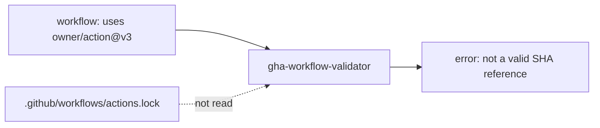
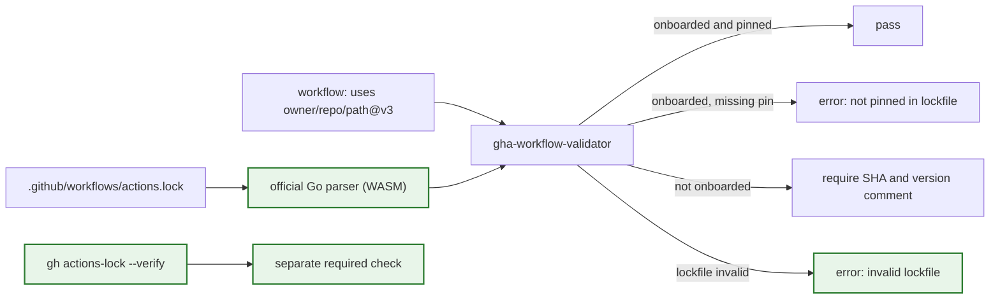

> **Sequencing:** the AST-based extractor in
> `changes/gha-workflow-validator-parser/` lands first. This proposal builds on
> its `UseReference` in place of `extractActionReferenceFromLine`.

# Accept workflow dependency lockfiles in gha-workflow-validator

## Context

`gha-workflow-validator` currently requires every third-party action reference
in a workflow to be a full commit SHA, and asks for a version comment beside it.
It exempts actions from a few trusted owners, but a reference such as
`dorny/paths-filter@v3.0.2` fails with "not a valid SHA reference."

GitHub now documents workflow dependency lockfiles. A repository can add
`.github/workflows/actions.lock`, generated by `gh actions-lock`, and onboard
workflows to it. Once onboarded, GitHub resolves each action through the
lockfile, and GitHub says SHA pinning in the workflow is no longer necessary.
The validator does not read the file, so it rejects the pattern the platform
recommends.

GitHub also publishes the authoritative lockfile implementation:
`github/actions-lockfile` exposes a Go parser that validates the schema,
canonicalizes pins, rejects path traversal, detects `uses` cycles, and enforces
the same rules the runner uses. `github/gh-actions-lock` builds the official CLI
on top of it, with `--verify` for full provenance checks and `--verify-local`
for offline coverage.

Reading the lockfile with a hand-written parser would duplicate a security
boundary and drift from the runner. The validator should consume the official
implementation instead, and leave provenance checks to the official CLI.

**Before**

**After**

## Goals and non-goals

**Why now:** GitHub's guidance changed, and the official parser now exists.
Keeping a second lockfile implementation in this repo would add work and a new
place for the two implementations to disagree.

**Success looks like:**

- A workflow listed in the lockfile passes with tag references and without
  version comments.
- An onboarded workflow that references an action missing from its lockfile
  entries fails with a message that names the fix.
- Pin lookup matches GitHub's grammar: `OWNER/REPO@REF`, with owner and repo
  lowercased, the ref case preserved, and any sub-action path dropped.
- An invalid lockfile fails the action with a positioned error on the lockfile
  instead of silently falling back.
- Workflows not in the lockfile keep today's SHA and version-comment rules.
- A companion workflow runs the official `gh actions-lock --verify` check, so
  provenance and reachability are verified by GitHub's implementation.

**Non-goals:**

- Reimplementing provenance, reachability, tag/commit mismatch, or repository
  identity checks. The official CLI owns those.
- Running `gh actions-lock` from inside the line validator. It stays a separate
  check.
- Generating or updating the lockfile.
- Relaxing validation for action definitions (`action.yml`) or offering an
  auto-fix.
- Adding a setting to turn lockfile support off. Detection is automatic.

## Decision

Use the official Go parser in the action through a small WebAssembly bridge. The
action ships the parser, reads the lockfile once, and uses the parsed
`workflows` map to decide whether a workflow is onboarded and whether a
reference is pinned. Parse failures are reported as lockfile errors. The
existing SHA and version-comment checks remain for workflows that are not
onboarded.

Add a separate reusable workflow that pins and runs the official
`gh actions-lock --verify` command. This gives us the full official check,
including the network-backed provenance checks the action should not duplicate.

This beats a hand-written parser because the official code is the same
implementation the runner and CLI rely on, and it already covers version
compatibility, pin canonicalization, path safety, and malformed input. It beats
using the CLI alone because the action still needs an offline, per-line answer,
and it needs inline annotations the CLI does not provide. Effort is hard: the
parser bridge adds a Go build and a binary artifact, and the change touches the
action, its build, its tests, and a reusable workflow.
