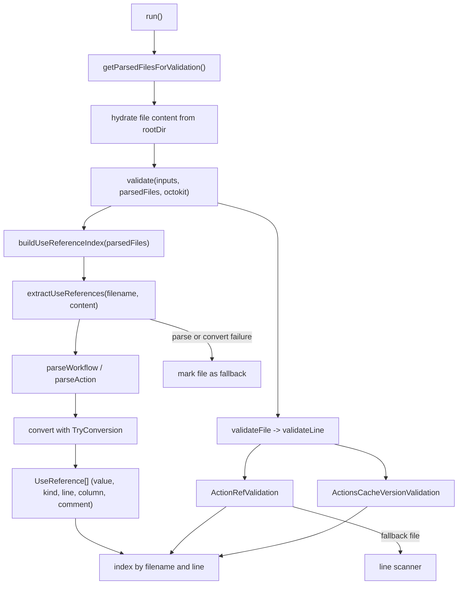

# Design: Use `@actions/workflow-parser` for extraction in gha-workflow-validator

## Context

Paths below are relative to `actions/gha-workflow-validator/` unless noted.

- `src/parse-files.ts` returns `ParsedFile { filename, lines }`. Line operation
  is `add` or `unchanged`; deleted lines are not tracked. `parseFiles` reads the
  file and immediately splits it, discarding the full document.
- `src/validations/validate.ts` builds the validators and loops files and lines.
  `ActionRefValidation.validateLine(line, filename)` extracts one reference from
  one line and applies four rules.
- `extractActionReferenceFromLine` is a text scanner. It requires the trimmed
  line to start with `uses: ` or `- uses: `, splits on `#`, splits the value on
  `/` and `@`, and treats a path ending in `.yml` as a reusable workflow.
- `ActionsCacheVersionValidation` reuses the same scanner to find
  `actions/cache` versions.
- GitHub publishes `@actions/workflow-parser` (currently `0.3.61`). It parses
  workflow and `action.yml` files against the workflow/action schemas, and
  exposes typed templates whose `StringToken` values carry `value`, `line`,
  `col`, and `range` (`start`/`end`, 1-based, end exclusive).
- `parseWorkflow` returns `{ context, value }`; errors live in `context.errors`.
  `convertWorkflowTemplate(context, value, provider, options)` returns
  `WorkflowTemplate`. `ActionStep.uses` is a `StringToken`;
  `ReusableWorkflowJob.ref` is a `StringToken`.
- `parseAction` and `convertActionTemplate` live at
  `@actions/workflow-parser/actions/index`. `ActionTemplate.runs` is either a
  composite, node, or Docker definition; composite runs carry `steps`.
- With `ErrorPolicy.TryConversion`, conversion still returns jobs and `uses`
  values when the file has unrelated schema errors (unknown top-level key,
  unknown step key, missing `runs-on`, bad `on`). Without it, conversion returns
  no jobs. This is mandatory.
- The package is ESM-only and imports its JSON schema without an import
  attribute, so raw Node ESM cannot import it. esbuild bundles the JSON, and
  Vitest handles it. `tsc` with the current `moduleResolution: node` resolves
  the root and `@actions/workflow-parser/actions/index` via `typesVersions`; the
  shorter `/actions` path does not resolve.
- `@actions/languageservice` contains the same traversal pattern and the
  canonical `uses` grammar rules in `src/utils/validate-uses.ts` and
  `src/action.ts`. It is a good specification and test oracle, but its
  `validate()` returns schema, expression, cron, and value-provider diagnostics
  and depends on `vscode-languageserver-types`. It should not be a runtime
  dependency of this action.
- The lockfile work in `changes/gha-workflow-validator-lockfiles/` is the
  follow-up. It needs a reliable reference with a `kind` and a source position.

## Approach



**Extractor.** New `src/use-references.ts`:

```ts
export type UseKind = "action" | "docker" | "local" | "reusable-workflow";

export interface UseReference {
  filename: string;
  value: string;
  kind: UseKind;
  line: number; // 1-based, where the value starts
  column: number; // 1-based
  comment?: string; // trailing YAML comment after the value
}

export interface UseReferenceIndex {
  /** A list means the file was parsed. "fallback" means use the line scanner. */
  get(filename: string, lineNumber: number): UseReference[] | "fallback";
}

export function extractUseReferences(
  filename: string,
  content: string,
): UseReference[] | undefined;
export function buildUseReferenceIndex(files: ParsedFile[]): UseReferenceIndex;
```

`undefined` means the parser could not produce a template, so the caller marks
the file for fallback. An empty list is a valid parsed file with no references.
The filename extension selects the parser: `action.yml`/`action.yaml` uses
`parseAction`, everything else uses `parseWorkflow`.

**Workflow parsing.**

```ts
const result = parseWorkflow(
  { name: filename, content },
  new NoOperationTraceWriter(),
);
if (!result.value) return undefined;

const template = await convertWorkflowTemplate(
  result.context,
  result.value,
  undefined,
  { errorPolicy: ErrorPolicy.TryConversion },
);
```

For each job:

- `job.type === "reusableWorkflowJob"` produces one `reusable-workflow`
  reference from `job.ref` (`value`, `range`). The validator skips it, matching
  today's behavior. It is kept so the index describes the file completely.
- `job.type === "job"` walks `job.steps`; each `ActionStep.uses` produces a
  reference classified by value:
  - `docker://` → `docker`
  - `./`, `.\`, `$/` → `local`
  - anything else → `action`

**Action parsing.** `parseAction` + `convertActionTemplate` with
`errorPolicy: TryConversion`. Only `runs.using === "composite"` contributes
references, from `runs.steps`. This gives composite actions the same
classification and positions. Node and Docker actions contribute nothing.
Landing action files can be a second stacked change if the first one grows past
the PR size limit.

**Index.** `buildUseReferenceIndex` parses each file once and stores
`Map<filename, UseReference[] | "fallback">` plus a per-line lookup. Multiple
references on one line are preserved in order. The index is built once per run
after content hydration.

**Content hydration.** Add `content?: string` to `ParsedFile`.

- `parseFiles` sets `content` from the string it already reads.
- `getParsedFilesForValidation` hydrates files that only have diff lines. Read
  `join(inputs.rootDir, file.filename)` after resolving both paths and checking
  the result stays under `rootDir`. A failed read leaves `content` undefined.
- Guard against a stale or wrong checkout: for every `add` line, compare the
  diff line content with `content.split("\n")[lineNumber - 1]`. If any line
  differs, discard `content` for that file and use the fallback. This covers
  `pull_request_target`, a checkout at the base commit, and fork layouts.
- `diffOnly` still works: only files in the diff are hydrated.

**Validation wiring.**

- `validate()` builds the index and passes it to `ActionRefValidation` and
  `ActionsCacheVersionValidation` through their options. Skip building it when
  neither check is enabled.
- `ActionRefValidation.validateLine` looks up references for
  `(filename, line.lineNumber)`.
  - `"fallback"` → call `extractActionReferenceFromLine(line)` as today.
  - `[]` → no messages.
  - references → convert each `action` reference to `ActionReference` and run
    the existing rule functions. `docker`, `local`, and `reusable-workflow`
    references return no messages.
- `toActionReference(use)` mirrors `parseActionReference` from the language
  service: split on the first `@`, split the identifier on `/` or `\`, drop
  empty segments, require owner and repo, and keep the sub-action path in
  `repoPath`. A malformed `action` value produces a new `uses-format` error
  (`Expected format {owner}/{repo}[/path]@{ref}`) instead of today's
  `undefined is not a valid SHA reference`. This is the same rule set the
  language service applies, without adopting its diagnostic engine.
- `ActionsCacheVersionValidation` reads `kind === "action"` references and
  checks `owner === "actions" && repo === "cache"`. Keep the current severity
  rule: error on `add`, warning otherwise.
- Add `ValidationType.USES_FORMAT` for the new format error.
- `IgnoresCommentValidation` and the line loop are unchanged.

**Comments.** YAML comments are not in the AST. The extractor derives the
version comment from the raw line: take the text after `range.end.column - 1` on
the value's end line, trim leading spaces, and keep it if it starts with `#`.
This is more precise than splitting the whole line on `#`, and it works for
quoted values. A comment on the `uses:` key line before a multi-line value is
not associated with the reference; that formatting is not used in this
repository.

**Fallback.** Parsing or conversion failures, missing content, and content
mismatches mark the file as fallback. The validator then uses the old scanner
for that file and logs the reason at debug level. The fallback is deliberately
silent in the summary: the action is not a YAML linter, and a parser limitation
should not become a new failure mode.

**Behavior changes.**

- `docker://` references no longer fail the SHA rule.
- Quoted, flow-style, and multi-line values are now validated.
- Step-level references that look like workflows
  (`owner/repo/.github/workflows/x.yml@ref`) were previously skipped by the
  `.yml` suffix heuristic. They are now treated as action references and must
  follow the action rules, which matches the platform: reusable workflows belong
  at `jobs.<job_id>.uses`, not in a step.
- Malformed remote references get a clear `uses-format` error instead of the old
  `undefined is not a valid SHA reference`.
- No message or severity changes for well-formed files.

**Dependency and build.**

- Add `@actions/workflow-parser` to `dependencies`, pinned exactly (`0.3.61`)
  because the package is pre-1.0 and the schema moves with it.
- esbuild bundles it into `dist/index.js`; the committed bundle grows by a few
  hundred KB. No new build target.
- Do not import the package from an unbundled Node entry point. The JSON import
  attribute failure is a packaging detail; the action and Vitest both go through
  a bundler.
- Add a changeset for the action.

## Related tools in `actions/languageservices`

| Package                                | What it offers                                                                                                        | Use here                                                        |
| -------------------------------------- | --------------------------------------------------------------------------------------------------------------------- | --------------------------------------------------------------- |
| `@actions/workflow-parser`             | Workflow and action AST with ranges, schema checks, typed templates                                                   | Adopt as the extraction layer                                   |
| `@actions/languageservice`             | `validateStepUsesFormat`, `parseActionReference`, reusable-workflow rules, action-input rules, expression diagnostics | Specification and test oracle; no runtime dependency            |
| `@actions/expressions`                 | Expression lexer, parser, evaluator, function metadata                                                                | Not needed directly; the parser already marks expression tokens |
| `workflow-parser/testdata/reader`      | Edge-case workflow corpus from the cross-language tests                                                               | Copy selected cases into fixtures                               |
| `languageserver`, `browser-playground` | LSP host and browser UI                                                                                               | Not applicable                                                  |

Notes from the review:

- `validateStepUsesFormat` is the closest thing to a canonical `uses` grammar:
  Docker, local (`./`, `.\`), self-repository (`$/`), remote
  `owner/repo[/path]@ref`, exactly one `@`, non-empty ref, and a warning for a
  short SHA. Port the cases, not the code. Its reusable-workflow-in-a-step error
  is a good future check but is out of scope here.
- `parseActionReference` has the same shape as the proposed `toActionReference`,
  including dropping empty path segments and preserving the sub-action path.
  Align error handling with it.
- `validate.self-repository-uses.test.ts` and `validate.uses-format.test.ts` are
  ready-made edge-case lists. Use them to seed fixtures.
- The language service's `validate()` is not a drop-in: it reports parser schema
  errors, expression errors, cron warnings, and value-provider diagnostics, and
  returns LSP `Diagnostic` objects. Filtering it down to action-ref policy would
  be more work than using the parser directly.
- `@actions/expressions` would only help if the action wanted to evaluate
  `runs-on: ${{ matrix.os }}` or `if` conditions. It should not; static policy
  checks should skip expressions, not guess their values.

## Rejected

- **Keep the line scanner.** It causes the Docker false positive, the suffix
  heuristic, and missed flow-style references.
- **Use `@actions/languageservice` `validate()` wholesale.** It reports
  diagnostics the action does not own, requires LSP types, and still needs the
  policy rules layered on top.
- **Use the language server as a subprocess.** Adds a runtime, a protocol, and
  no per-line policy.
- **Port the scanner to a hand-written YAML reader.** Duplicates the parser and
  drifts from the schema.
- **Migrate every line check at once.** Runner values need matrix awareness, and
  node versions come from remote action metadata. Keep this change to the
  reference extractor.
- **Add `@actions/expressions` now.** No current check evaluates expressions.

## Verification

- Extractor fixtures: plain, quoted, commented, sub-action path, Docker with a
  registry and tag, `./`, `.\`, `$/`, job-level reusable workflow, flow style
  with two references on one line, a value with a comment, a value on a
  following line, an unknown top-level key, an unknown step key, a missing
  `runs-on`, and invalid YAML (expect `undefined`).
- Action fixtures: composite action with `uses` steps; node action with no
  steps; Docker action with no steps.
- Index tests: mapping by line, multiple references on one line, comment
  extraction, and `"fallback"` for a file without content.
- Validator tests: Docker reference produces no SHA error; reusable workflow job
  is skipped; sub-action path is still parsed; malformed remote reference
  produces `uses-format`; trusted tag rule unchanged; cache version rule reads
  the index; a step-level `.yml` reference follows the action rules.
- Integration: `validate()` with a fixture checkout, with and without
  `diffOnly`; a diff whose added lines disagree with the file on disk falls
  back; a file absent from disk falls back.
- Run the project's test, build, `check-types`, and Prettier checks.
- Run the action against this repository's own `.github/workflows` and compare
  the output before and after. The expected changes are fewer Docker false
  positives, more references found in unusual YAML, and clearer `uses-format`
  messages for malformed references.

## Risks

- **Schema lag.** A newer valid workflow key is a schema error. `TryConversion`
  keeps references visible, and the fallback covers conversion failures. Test
  unknown-key cases.
- **The package is ESM-only.** Raw Node imports fail on its JSON schema import.
  The action and tests bundle it. Do not introduce an unbundled entry point.
- **Stale checkout.** `pull_request_target` or a base-commit checkout can
  disagree with the PR diff. The added-line consistency check falls back to the
  scanner rather than validating the wrong file.
- **Missing content in diff-only mode.** A file that is not on disk falls back.
  This is a false negative, but it matches today's behavior and is logged.
- **Multiple references on one line.** Both are validated; annotations remain
  per line, so the message does not say which reference. This is rare and no
  worse than today, where the scanner would only see the line.
- **Comment extraction.** A comment on a previous line is not associated with a
  multi-line value. Test the common forms; document the limitation.
- **Dependency churn.** Pin the exact version and update deliberately. The
  package is maintained for security fixes and breaking changes.
- **Upstream is in maintenance mode.** `actions/languageservices` says it is not
  taking contributions and will focus on security fixes and major breaking
  changes. Pin the exact version, keep the fallback, and be ready to vendor the
  parser if schema updates stop.
- **Fallback hides parser gaps.** Fallback is debug-logged, not warned. Review
  the debug output when testing a new workflow style.

## TODO

Effort: medium (two stack layers, two consumers, tests, and a dependency).

### Phase 1: Extract workflow references from the parser

- [ ] Add `@actions/workflow-parser` to `package.json` and the lockfile.
- [ ] Add `src/use-references.ts` with classification, ranges, comments,
      workflow parsing, and the index.
- [ ] Add `content` to `ParsedFile`, hydrate it in
      `getParsedFilesForValidation`, and add the added-line consistency check.
- [ ] Build the index once in `validate()` and pass it to `ActionRefValidation`.
- [ ] Replace the `.yml` suffix heuristic and the Docker misclassification in
      `ActionRefValidation`.
- [ ] Add the extractor, index, validator, and integration tests described
      above.
- [ ] Update the action README and add a changeset.

### Phase 2: Cover composite action files and the cache consumer

- [ ] Add the `parseAction`/`convertActionTemplate` branch to
      `extractUseReferences` and its fixtures.
- [ ] Pass the index to `ActionsCacheVersionValidation` and drop its direct
      line-scanner call where the index is available.
- [ ] Run the full test suite and rebuild `dist/index.js`.

Phase 1 and Phase 2 are separate stack layers so each PR stays under the
repository's size limit.

### Follow-ups, not this change

- [ ] Reusable workflow SHA rule. The lockfile does not pin
      `jobs.<job_id>.uses`, so onboarded workflows still need a commit SHA
      there. The parser exposes `ReusableWorkflowJob.ref` with a range; add the
      rule with the lockfile work.
- [ ] Runner validation from `runs-on` tokens, including a decision on matrix
      values. The current scanner sees runner names anywhere on a line,
      including `run:` strings and matrix entries; an AST version must decide
      which of those are real.
- [ ] Node-version validation from `parseAction` on the fetched remote
      `action.yml` instead of a regex.
- [ ] Action-input validation using the language service's metadata rules.
- [ ] Lockfile parsing and coverage from
      `changes/gha-workflow-validator-lockfiles/`. Its `extractActionReference`
      step becomes a `UseReference` lookup; it should be rebased on this change.
