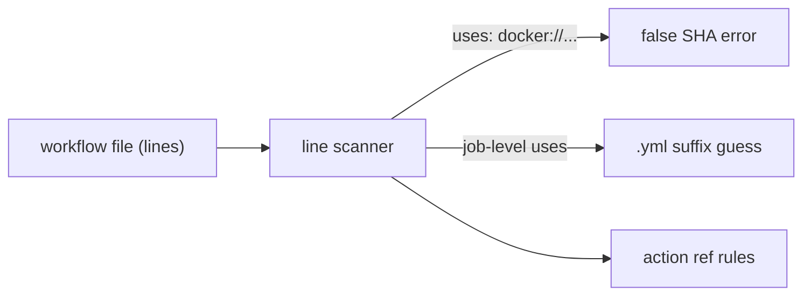
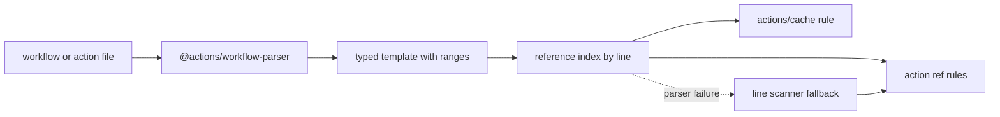

# Parse workflows with GitHub's workflow parser in gha-workflow-validator

## Context

`gha-workflow-validator` reads workflow and action files as lines. Every check
starts with a hand-written string scan, and the most important one is
`extractActionReferenceFromLine` in
`actions/gha-workflow-validator/src/validations/action-reference-validations.ts`.

That scanner assumes the trimmed line starts with `uses: ` or `- uses: `, splits
the value on `#` for the version comment, splits the identifier on `/` and `@`,
and guesses that a reference to a reusable workflow is a workflow when its path
ends in `.yml`. It works for the common formatting, but it is not reading YAML.
It misses quoted and flow-style values, and it misreads:

- `uses: docker://alpine:3.19`, which is parsed as owner `docker:`, an empty
  repo, and an undefined ref, then fails with
  `undefined is not a valid SHA reference`.
- A job-level `uses:` to a reusable workflow, which is only skipped because of
  the `.yml` suffix guess.
- Two references on one line, which the line model cannot attribute.
- Columns, which the line model does not carry.

GitHub publishes the parser behind the VS Code extension and the Actions
language server: `@actions/workflow-parser`. It returns a schema-validated
template with source ranges for every `uses` and `runs-on`, for both workflow
files and `action.yml` files. It is the same family of implementation the
language service uses, and it is small enough to bundle into the action.

The lockfile work is a separate follow-up. That change needs a trustworthy
`uses` extractor that can say whether a reference is an action, a Docker image,
a local path, or a reusable workflow, and where it is. This change provides that
seam first.

**Before**

**After**

## Goals and non-goals

**Why now:** the line scanner causes false positives on valid workflows, and the
lockfile follow-up depends on correct `uses` classification. Replacing the
scanner before adding lockfile rules avoids building the new feature on the old
parser.

**Success looks like:**

- Workflow references are extracted from the parsed template, not from text.
- Docker, local (`./`, `.\`, `$/`), and reusable workflow references are
  classified correctly and are not treated as remote actions.
- Two references on one line are both validated.
- Existing rule outcomes do not change for well-formed workflows.
- A parser failure never silently skips a file; the line scanner runs instead.
- The lockfile follow-up can consume a `UseReference` with a `kind` and a source
  position.

**Non-goals:**

- Parsing, validating, or reading `.github/workflows/actions.lock`. That is the
  follow-up proposal.
- Full workflow schema validation or syntax linting. `actionlint` already runs
  in this repository, and the action should not duplicate its diagnostics.
- Migrating the runner or node-version checks to the parser. Runner values have
  a matrix caveat; node versions come from remote `action.yml` files. Both are
  reasonable follow-ups, listed at the end.
- Evaluating `${{ }}` expressions. The parser surfaces expression tokens, and
  the validator skips them.
- Validating action inputs against action metadata. The language service does
  this; it is a separate feature.
- Changing annotation format or ignore-comment behavior.

## Decision

Adopt `@actions/workflow-parser` as the extraction layer for action references.
Parse each candidate file once, build an index of references keyed by line, and
keep the existing line-based validation loop and rule functions. Use
`ErrorPolicy.TryConversion` so unrelated schema errors do not hide references,
and ignore the parser's schema diagnostics. When the parser cannot produce a
template, fall back to the existing scanner and log why.

Migrate `ActionsCacheVersionValidation` to the same index because it already
depends on the action-reference scanner. Leave the runner, node-version, and
ignore-comment checks unchanged in this change.

The other packages in `actions/languageservices` were evaluated:

- `@actions/languageservice` has the closest reference implementation of `uses`
  grammar and test cases (`validate.uses-format.test.ts`,
  `validate.self-repository-uses.test.ts`). Use it as a specification and test
  oracle, not a runtime dependency; its `validate()` returns schema, expression,
  and cron diagnostics that this action should not emit.
- `@actions/expressions` is not needed directly. The workflow parser already
  marks expression tokens, and this action does not evaluate expressions.
- `workflow-parser/testdata/reader` is a useful corpus of edge-case workflows.
  Copy selected cases into fixtures instead of depending on the upstream repo.
- `languageserver` and `browser-playground` are not relevant to a CI check.

This is a smaller and safer change than adopting the full language service, and
it removes the largest source of false positives without changing the action's
policy or its output shape.
