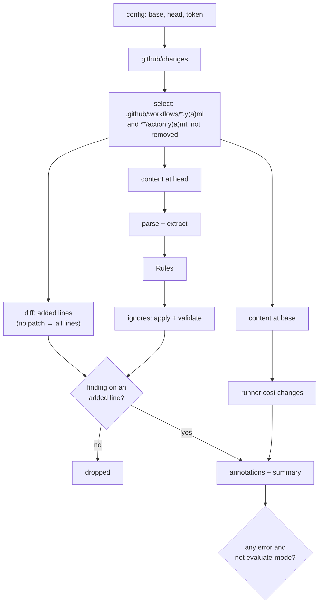
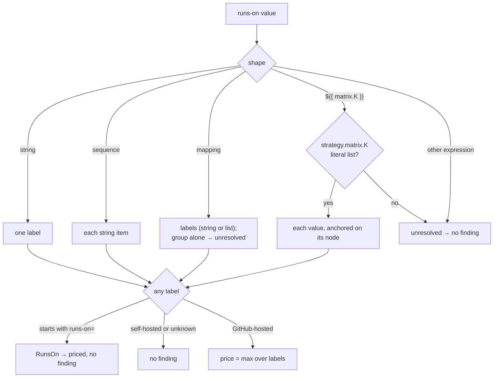
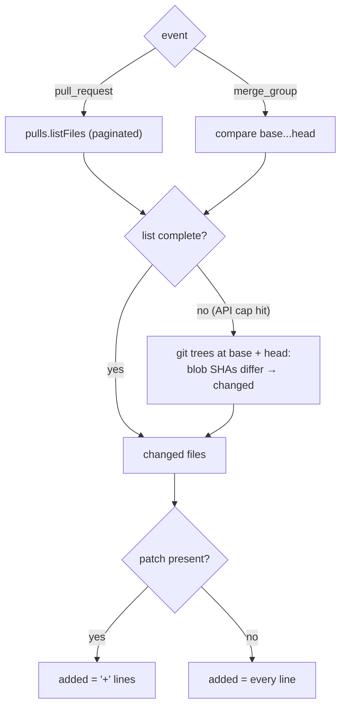

# Design: gha-workflow-validator v2

## Context

The action lives in `actions/gha-workflow-validator/`. It is a `node24` action
that nx builds with esbuild into a committed `dist/index.js`. Tests use vitest,
and GitHub API calls are recorded with nock.

v2 replaces all of `src/`. Nothing from v1's line model (`FileLine`,
`parse-files.ts`, the per-rule regex parsers) survives. What carries over:

- The build setup (`project.json`, esbuild, committed `dist/`).
- The trusted owners: `actions`, `github`, `smartcontractkit`.
- v1's known bugs, each turned into a regression test (listed under
  Verification).

The one caller is
`gha-org-workflows/.github/workflows/gha-workflow-validation.yml`, on
`pull_request` and `merge_group`.

`yaml@2.9.1` is already a dependency of `advanced-triggers`,
`actions-dependencies-updater`, and `update-action-versions`.

## Approach

### Module layout

```text
src/
  index.ts              entry, calls run()
  run.ts                orchestration only
  config.ts             inputs + event context (base/head SHA)
  github/
    changes.ts          changed files + patches for a PR or merge group
    content.ts          file text at a SHA (memoized, 8 in flight)
  diff.ts               patch → added line numbers
  parse/
    model.ts            Span, Ref, RunnerSpec, FileDoc
    yaml.ts             text → yaml Document + LineCounter + syntax errors
    extract.ts          Document → FileDoc (workflow or action)
  refs.ts               "owner/repo/path@ref" + trailing comment → Ref
  pins.ts               pinStatus(ref, ctx): the one place that decides "is this pinned?"
  runners/
    classify.ts         label(s) → RunnerClass
    prices.ts           dated price table
    estimate.ts         RunnerClass → cost line + RunsOn suggestion
  ignores.ts            parse ghv-ignore comments, apply, ignore-syntax, unused-ignore
  rules/
    index.ts            registry
    pinned-ref.ts
    version-comment.ts
    internal-ref.ts
    docker-digest.ts
    runner-cost.ts
    yaml-syntax.ts
  report/
    annotations.ts
    summary.ts          findings, ignores, runner cost changes
    messages.ts         fix text per rule
```

### Pipeline



Rules see every node in the file. They don't know about the diff. One filter
step keeps findings that count, based on their `scope`:

- **`line`:** kept when the anchor line (`span.start.line`) was added. Used by
  ref and runner rules.
- **`file`:** kept when the file changed in the PR. Used by `yaml-syntax` and
  `internal-error`, and later by lockfile findings.

### Model

```ts
type Span = {
  start: { line: number; col: number };
  end: { line: number; col: number };
};

type Ref = {
  raw: string; // "actions/checkout@abc… " as written, unquoted
  kind: "remote" | "local" | "docker";
  owner?: string; // lowercased
  repo?: string;
  path?: string;
  ref?: string; // part after @
  image?: string; // docker only
  digest?: string; // docker only, sha256:…
  comment?: string; // trailing comment text, minus any ghv-ignore part
  trusted: boolean;
  site: "step" | "reusable"; // steps[*].uses vs jobs.<id>.uses
  span: Span;
};

type RunnerSpec = {
  jobId: string;
  labels: { value: string; span: Span }[]; // resolved labels
  unresolved: boolean; // expression we can't evaluate
  span: Span;
};

type FileDoc = {
  path: string; // repo-relative
  kind: "workflow" | "action";
  text: string;
  refs: Ref[];
  runners: RunnerSpec[];
  syntaxErrors: { message: string; span: Span }[];
};

type Finding = {
  rule: RuleId;
  severity: "error" | "warning";
  message: string;
  path: string;
  span: Span;
  scope: "line" | "file";
  ignored?: { reason: string };
};

// Built once per run in run.ts. Rules read repo-wide inputs from here, never
// from the network.
type RuleContext = {
  trustedOwners: ReadonlySet<string>;
  // later: lockfile?: Lockfile
};

type Rule = {
  id: RuleId;
  ignorable: boolean;
  check: (doc: FileDoc, ctx: RuleContext) => Finding[];
};

type PinStatus = { pinned: true; via: "sha" } | { pinned: false }; // later: { pinned: true; via: "lockfile"; commit: string }
```

`pinned-ref` and `version-comment` never test the ref string themselves. They
call `pinStatus(ref, ctx)` from `pins.ts`. In v2.0 it returns `via: "sha"` for a
full SHA and `pinned: false` otherwise.

### Parsing

`parse/yaml.ts` calls `parseDocument(text, { keepSourceTokens: true })` with a
`LineCounter`, so every node's `range` maps to line and column. Syntax errors
come from `doc.errors`.

`parse/extract.ts` walks the document by key. It never builds a full workflow
model:

| File kind | Paths read                                                                                    |
| --------- | --------------------------------------------------------------------------------------------- |
| workflow  | `jobs.<id>.steps[*].uses`, `jobs.<id>.uses`, `jobs.<id>.runs-on`, `jobs.<id>.strategy.matrix` |
| action    | `runs.steps[*].uses`                                                                          |

Notes:

- **Only real keys.** `uses:` text inside a `run: |` block is a string value
  under `run`, so the walk never sees it. That fixes v1's false positive.
- **Comments.** The version comment is the source text after the `uses` value
  node's end, on the same line, after `#`. Reading source text is more reliable
  than the `yaml` package's comment attachment, which moves comments between
  nodes depending on layout.
- **Aliases** (`*anchor`) resolve to the anchored node, so the span points at
  the anchor. If only the alias line changed, the finding is not on an added
  line and drops. This is rare in workflows and favors precision.
- **Syntax errors.** If the document has errors, extraction still runs on
  whatever parsed, and `yaml-syntax` reports each error.

### Refs

`refs.ts` parses the `uses` value:

| Value                                                        | kind                    | Ref rules apply?     |
| ------------------------------------------------------------ | ----------------------- | -------------------- |
| `./path`, `$/path`                                           | local                   | no                   |
| `docker://image:tag`, `docker://img@sha256:…`                | docker                  | `docker-digest` only |
| `owner/repo@ref`, `owner/repo/path@ref`                      | remote                  | yes                  |
| `owner/repo/.github/workflows/x.yml@ref` at `jobs.<id>.uses` | remote, site `reusable` | yes                  |

A full SHA is `/^[0-9a-f]{40}$/` or `/^[0-9a-f]{64}$/`. `trusted` is a lowercase
match on `owner`.

### Rules, with examples

All examples are lines the PR adds.

#### `pinned-ref` (error)

Third-party remote ref, step or reusable workflow, not a full SHA.

```yaml
# ❌ fails
- uses: tj-actions/changed-files@v45
- uses: some-org/setup-thing@main
jobs:
  scan:
    uses: other-org/workflows/.github/workflows/scan.yml@v2   # reusable call, new in v2

# ✅ passes
- uses: tj-actions/changed-files@ed68ef82c095e0d48ec87eccea555d944a631a4c # v46.0.5
- uses: actions/checkout@v4                       # trusted owner
- uses: smartcontractkit/.github/actions/foo@foo/v1  # trusted owner
- uses: ./.github/actions/local-thing             # local
```

#### `version-comment` (warning)

Third-party ref pinned to a SHA with an empty trailing comment.

```yaml
# ❌ warns
- uses: tj-actions/changed-files@ed68ef82c095e0d48ec87eccea555d944a631a4c

# ✅ passes
- uses: tj-actions/changed-files@ed68ef82c095e0d48ec87eccea555d944a631a4c # v46.0.5
```

Any non-empty comment passes. Checking that the SHA matches the tag needs the
network, so it's a non-goal.

#### `internal-ref` (warning)

A `smartcontractkit` ref pinned to a SHA. A SHA pin stops moved major tags from
reaching the repo. `actions` and `github` refs may use either form.

```yaml
# ❌ warns
- uses: smartcontractkit/.github/actions/ci-lint-go@0b1c2d3e4f5a6b7c8d9e0f1a2b3c4d5e6f7a8b9c # ci-lint-go@2.1.0

# ✅ passes
- uses: smartcontractkit/.github/actions/ci-lint-go@ci-lint-go/v2
- uses: actions/checkout@08eba0b27e820071cde6df949e0beb9ba4906955 # v4.3.0
```

#### `docker-digest` (warning)

```yaml
# ❌ warns
- uses: docker://alpine:3.20

# ✅ passes
- uses: docker://alpine@sha256:beefdbd8a1da6d2915566fde36db9db0b524eb737fc57cd1367effd16dc0d06d
```

#### `runner-cost` (warning or error)

See [Runner cost](#runner-cost) for how labels are classified and priced.

```yaml
# ❌ error ($0.042/min or more)
runs-on: ubuntu-latest-16cores
runs-on: "ubuntu22.04-32cores-128GB" # quoted: missed by v1
runs-on: [ubuntu-latest-64cores-256gb] # array: missed by v1
runs-on: { group: larger, labels: windows-latest-8cores }
runs-on: macos-latest-xlarge

# ⚠️ warning
runs-on: ubuntu-latest-4cores # $0.012/min
runs-on: windows-latest # $0.010/min
runs-on: macos-latest # $0.062/min, no RunsOn option
strategy:
  matrix:
    os: [ubuntu-latest, macos-latest] # anchors on the matrix value
runs-on: ${{ matrix.os }}

# ✅ passes
runs-on: ubuntu-latest
runs-on: ubuntu-24.04-arm
runs-on: runs-on=${{ github.run_id }}/cpu=16/family=c8i/image=ubuntu24-full-x64
runs-on: [self-hosted, linux]
runs-on: ${{ inputs.runner }} # unresolved: caller decides
runs-on: ubuntu-latest-16cores # ghv-ignore: runner-cost perf baseline must match GitHub hardware
```

#### `yaml-syntax` (error, not ignorable)

Reported when the file changed in the PR, anchored at the error position. A YAML
error in a file the PR touches would also hide refs from every other rule, so it
can't be bypassed.

```yaml
# ❌ fails
steps:
  - uses: actions/checkout@v4
     with:            # bad indent
```

#### `ignore-syntax` (error) and `unused-ignore` (warning)

```yaml
# ❌ ignore-syntax
runs-on: ubuntu-latest-16cores # ghv-ignore!
runs-on: ubuntu-latest-16cores # ghv-ignore: runner-cost
runs-on: ubuntu-latest-16cores # ghv-ignore: runner-size big build
- uses: foo/bar@v1 # ghv-ignore: yaml-syntax broken on purpose   # not ignorable

# ⚠️ unused-ignore
runs-on: ubuntu-latest # ghv-ignore: runner-cost legacy

# ✅ passes
- uses: foo/bar@v1 # ghv-ignore: pinned-ref vendor publishes no tags; tracked in DX-1234
- uses: foo/bar@ed68ef82c095e0d48ec87eccea555d944a631a4c # v1.2.0 # ghv-ignore: version-comment n/a
```

#### `internal-error` (error, not ignorable)

A file we could not fetch, a parser throw, or an API failure. The check fails
closed, so a file crafted to crash the parser can't hide an unpinned ref.
`evaluate-mode` in the org workflow is the escape hatch while we fix it.

### Ignore comments

Grammar, matched against a line's comment text:

```text
ghv-ignore: <rule>[,<rule>…] <reason>
```

- `<rule>` must be an ignorable rule ID: `pinned-ref`, `version-comment`,
  `internal-ref`, `docker-digest`, or `runner-cost`.
- `<reason>` is required and must not be empty.
- The comment must be on the finding's anchor line. For a `runs-on` sequence,
  that's the label's line. For a matrix, it's the matrix value's line.
- The comment can follow a version comment (`@<sha> # v1.2.0 # ghv-ignore: …`).
  `refs.ts` strips the `ghv-ignore` part before it reads the version.
- Any other line containing `ghv-ignore` (`ghv-ignore!`, a missing reason, an
  unknown rule) is `ignore-syntax`.

`ignores.ts` runs after the rules. A matched finding keeps its severity for the
record but gets `ignored: { reason }`. It shows in the summary's Ignored table
and is left out of annotations and the exit code. A valid ignore on an added
line that matched nothing is `unused-ignore`.

### Runner cost

#### Classification

`runners/classify.ts` turns one job's `runs-on` into a `RunnerClass`:



GitHub-hosted labels:

| Pattern                                                            | Class                   |
| ------------------------------------------------------------------ | ----------------------- |
| `ubuntu-slim`                                                      | Linux 1-core            |
| `ubuntu-latest`, `ubuntu-24.04`, `ubuntu-22.04`                    | Linux 2-core x64        |
| `ubuntu-24.04-arm`, `ubuntu-22.04-arm`                             | Linux 2-core arm64      |
| `windows-latest`, `windows-2025`, `windows-2022`, `windows-11-arm` | Windows 2-core          |
| `macos-latest`, `macos-<n>`, `macos-<n>-intel`                     | macOS standard          |
| `macos-<…>-large`                                                  | macOS 12-core (x64)     |
| `macos-<…>-xlarge`                                                 | macOS 5-core M2 Pro     |
| `(ubuntu\|linux)…(\d+)cores?…`, plus `arm` anywhere for arm64      | Linux larger, N cores   |
| `windows…(\d+)cores?…`                                             | Windows larger, N cores |

Larger runners are named by each org, so the `<N>cores` pattern is the same
convention v1 relies on. A larger runner named without a core count is treated
as unknown and gets no finding. That trades a miss for no false positive.

#### Prices

`runners/prices.ts` holds the table, with `asOf` and source URLs. The summary
footer prints `asOf`.

GitHub-hosted, $/min
([source](https://docs.github.com/en/billing/reference/actions-runner-pricing),
read 2026-11-10):

| Cores | Linux x64 | Linux arm64 | Windows x64 |
| ----- | --------- | ----------- | ----------- |
| 1     | 0.002     | —           | —           |
| 2     | 0.006     | 0.005       | 0.010       |
| 4     | 0.012     | 0.008       | 0.022       |
| 8     | 0.022     | 0.014       | 0.042       |
| 16    | 0.042     | 0.026       | 0.082       |
| 32    | 0.082     | 0.050       | 0.162       |
| 64    | 0.162     | 0.098       | 0.322       |
| 96    | 0.252     | —           | 0.552       |

macOS: standard 0.062, 12-core 0.077, 5-core M2 Pro 0.102.

RunsOn estimates track the **latest EC2 generation**, not a fixed family.
`prices.ts` names one reference family per architecture, and a new AWS
generation means editing that entry plus its rates:

```ts
export const LATEST_GENERATION = {
  x64: { generation: 8, family: "c8i" }, // AWS has no x64 gen 9 yet
  arm64: { generation: 9, family: "c9g" }, // Graviton5
} as const;
```

`c8i` is the cheaper of the two gen-8 x64 compute families (`c8a` costs about
15% more). Rates are AWS on-demand Linux, in $/min, from Vantage
([c8i](https://instances.vantage.sh/aws/ec2/c8i.large),
[c9g](https://instances.vantage.sh/aws/ec2/c9g.large), read 2026-11-10). The 30
GB gp3 root volume adds under $0.0001/min, which rounds away:

| CPUs | c8i (x64) | vs GitHub | c9g (arm64) | vs GitHub |
| ---- | --------- | --------- | ----------- | --------- |
| 2    | 0.0016    | 3.8×      | 0.0014      | 3.6×      |
| 4    | 0.0031    | 3.9×      | 0.0029      | 2.8×      |
| 8    | 0.0062    | 3.5×      | 0.0058      | 2.4×      |
| 16   | 0.0125    | 3.4×      | 0.0116      | 2.2×      |
| 32   | 0.0250    | 3.3×      | 0.0232      | 2.2×      |
| 64   | 0.0500    | 3.2×      | 0.0464      | 2.1×      |
| 96   | 0.0750    | 3.4×      | —           | —         |

The suggested label leaves out `family=`. The message tells people to pick a
latest-generation family instead, and will link to RunsOn family guidance in the
`runs-on` repo once it's written.

Every RunsOn estimate carries the note: "On-demand price. Spot instances can cut
this by about 2.5×." The ratio comes from RunsOn's
[pricing page](https://runs-on.com/pricing/) spot rates (7-day us-east-1
average) against the on-demand rates above: c8i.4xlarge $0.0051 vs $0.0125, and
m9g.4xlarge $0.0054 vs $0.0130. Windows RunsOn rates are left out until we have
a verified source, so Windows findings show the GitHub price and point to RunsOn
without a number. There is no GitHub platform fee on self-hosted runners.

#### Messages

`runners/estimate.ts` builds the cost line and suggestion. It rounds a GitHub
runner's CPU count up to the next RunsOn size:

```text
runner-cost: ubuntu-latest-16cores costs $0.042/min ($2.52/hr), 7× the standard runner.
Use RunsOn first: a 16-CPU latest-generation RunsOn runner costs about $0.0125/min on-demand, 3.4× cheaper.
On-demand price. Spot instances can cut this by about 2.5×.
  runs-on: runs-on=${{ github.run_id }}/cpu=16/image=ubuntu24-full-x64
Pick the latest EC2 generation for `family=` (today: 9 for arm64, 8 for x64).
  Docs: https://github.com/smartcontractkit/runs-on
Only if RunsOn can't work for this job, keep this runner and add:
  # ghv-ignore: runner-cost <why RunsOn doesn't work>
```

For macOS the RunsOn lines are replaced with "RunsOn has no macOS runners. Use
Linux if this job doesn't need macOS."

#### Cost changes in the summary

For each changed workflow, `report/summary.ts` parses the base version too and
pairs jobs by ID. Any job whose runner class changed, or which is new, gets a
row. RunsOn labels with `cpu=N` (or `cpu=N+M`, priced at N) are priced at the
latest-generation rate for their architecture: arm64 when the image ends in
`arm64`, otherwise x64. The label's `family=` doesn't change the estimate. It's
a ballpark figure, not a quote for that exact instance.

```markdown
### Runner cost changes

| Workflow | Job   | Before                  | After                   | $/min before → after | Change |
| -------- | ----- | ----------------------- | ----------------------- | -------------------- | ------ |
| ci.yml   | build | `ubuntu-latest`         | `ubuntu-latest-16cores` | 0.006 → 0.042        | +600%  |
| ci.yml   | e2e   | `ubuntu-latest-32cores` | `runs-on=…/cpu=32/…`    | 0.082 → 0.0250       | −70%   |
| ci.yml   | lint  | —                       | `ubuntu-latest`         | — → 0.006            | new    |

Prices as of 2026-11-10. List prices per minute, not a bill. RunsOn on-demand;
spot is cheaper.
```

The summary is informational. It never changes severity. If the base content
can't be fetched, the table says so and the run continues.

### Sources and the diff



- **Base and head.** `pull_request`: `pull_request.base.sha` and
  `pull_request.head.sha`. `merge_group`: `merge_group.base_sha` and
  `merge_group.head_sha`. Other events: log a notice and exit 0.
- **Selection.** Paths matching `.github/workflows/*.yml|yaml` or ending in
  `action.yml|yaml`. Status `removed` is skipped. Renamed files are checked like
  modified ones. Selection is a list of `{ match, kind }` entries, so a new file
  kind is one more entry.
- **Content** is fetched from the API at head (base too, for the cost table),
  memoized, at most 8 in flight. No checkout is needed.
- **Truncation.** The listing APIs cap the number of files they return. When
  that happens, comparing the recursive git trees at base and head finds the
  changed workflow and action files, which then count as fully added. So nothing
  is skipped silently.
- **Permissions.** The token needs `contents: read` and `pull-requests: read`.

### Inputs

| Input           | Default               | Meaning                                                             |
| --------------- | --------------------- | ------------------------------------------------------------------- |
| `github-token`  | `${{ github.token }}` | Token for the API calls above                                       |
| `evaluate-mode` | `false`               | Report everything, never fail. For the shadow week and emergencies. |

No per-rule toggles. The org workflow is the only caller, and per-line ignores
cover the legitimate exceptions.

### Output

- **Annotations.** One per non-ignored finding, at `path`, `span`, with the rule
  ID as title and the fix text from `report/messages.ts`.
- **Job summary.** Sections in this order: Errors, Warnings, Ignored (rule,
  location, reason), Runner cost changes, and a short "how to fix" footer
  linking the README. Empty sections are left out.
- **Exit.** Fail if any non-ignored error remains and `evaluate-mode` is false.

### Room for lockfile support

v2.0 doesn't read
[lockfiles](https://docs.github.com/en/actions/concepts/security/workflow-dependency-lockfiles),
but these choices keep the door open. Each is something v2.0 needs anyway, so
none of it is speculative code:

| Seam                           | Why v2.0 needs it                                    | What lockfile support adds                                                                                                                              |
| ------------------------------ | ---------------------------------------------------- | ------------------------------------------------------------------------------------------------------------------------------------------------------- |
| `pinStatus(ref, ctx)`          | One place for the SHA test, shared by two rules      | Returns `{ pinned: true, via: "lockfile", commit }` for a step ref listed for an onboarded workflow. `pinned-ref` and `version-comment` stay unchanged. |
| `RuleContext`                  | Holds trusted owners, built once per run             | Adds `lockfile?: Lockfile`, parsed from `.github/workflows/actions.lock` at head                                                                        |
| `Finding.scope: "file"`        | `yaml-syntax` and `internal-error` aren't line-bound | Lockfile findings (missing or stale entry) count when the workflow or `actions.lock` changed                                                            |
| Selection `{ match, kind }`    | Workflows and actions are two kinds                  | A `lockfile` kind. Fetched at head even when unchanged, because it changes how other files are judged.                                                  |
| `Ref.raw` as written           | Messages quote the ref as the user wrote it          | Matches the lockfile's dep key format (`owner/repo@v3.1.0`)                                                                                             |
| `Ref.site`                     | `pinned-ref` covers steps and reusable calls         | Lockfiles cover steps only, so `site: "reusable"` refs still need a SHA                                                                                 |
| Rule registry + ignore grammar | Ignorable rule IDs come from the registry            | A new `lockfile` rule is ignorable or not by setting one flag                                                                                           |

That work would add `lockfile/read.ts`, `rules/lockfile.ts`, one branch in
`pins.ts`, and one selection entry.

Open questions for that proposal, not this one:

- **Moving major tags.** A lockfile freezes `smartcontractkit/...@v1` at a
  commit, so a moved tag no longer reaches the repo. Options: lock only
  third-party refs, or rely on Dependabot lockfile updates when a tag moves.
- **Freshness.** Our offline check can confirm the lockfile's shape and that
  every ref is listed. It can't detect moved tags; that needs
  `gh actions-lock --verify`, which would run as its own step.
- **Format stability.** The format is at `version: v0.0.3`. An unknown version
  should fall back to the SHA rules, which is the strict choice.

### Rejected options

- **`@actions/workflow-parser`.** See the proposal. It adds schema checks we
  don't want in a required gate and comes with pre-1.0 and packaging risk.
- **actionlint inside the action.** See the proposal. Run it as a separate,
  non-required job if wanted.
- **Lockfile support in v2.0.** See the proposal. It conflicts with moving major
  tags until the org decides how they coexist. The seams above keep it cheap to
  add later.
- **A bypass PR label or a central exceptions file.** A label needs `labeled`
  triggers, and anyone with write access can apply it. A central file is slow to
  update and moves the decision away from the code's reviewers. An inline ignore
  with a reason is reviewed right where the change is.
- **Network lookups in rules** (node versions, SHA↔tag checks). Every lookup is
  a way for a required check to flake.
- **Keeping v1 inputs or a parity suite.** There's one caller and the version is
  a major bump. v1's known bugs become regression tests instead.

## Verification

Standard: `pnpm nx run gha-workflow-validator:test`, `:check-types`, `:build`,
and `pnpm lint:affected`.

Behavioral checks:

- **Rule examples.** Every ❌, ⚠️, and ✅ snippet in this design is a test case,
  asserting rule, severity, and line.
- **v1 regressions.** Each of these must now be caught or now pass:
  - A quoted runner label, a label array, and a `{group, labels}` runner are
    caught.
  - `uses:` inside a `run: |` block is not flagged.
  - A file with no patch is checked in full.
  - A third-party reusable workflow at a tag is flagged.
  - A 64-character SHA-256 ref is accepted.
  - A `docker://` ref no longer crashes the rule.
  - A file never appears twice in the output.
- **Real-world corpus.** Every `.github/workflows/*.yml` and
  `actions/*/action.yml` in this monorepo goes through parse + extract. The test
  asserts no throws and snapshots the ref and runner counts per file, so a
  `yaml` upgrade that changes extraction shows as a snapshot diff.
- **Diff and sources.** Recorded nock fixtures cover a PR, a merge group, a file
  with no patch, a truncated file list (tree fallback), a removed file, a
  renamed file, and a failed content fetch (`internal-error`).
- **Cost table.** A changed runner, a new job, a move to RunsOn, and a failed
  base fetch.
- **Bundle smoke.** `scripts/test.sh` runs the built `dist/index.js` against a
  recorded PR, proving the bundle loads under plain Node 24.
- **Shadow week.** v2 runs next to v1 in the org workflow in `evaluate-mode` for
  one week. Compare their summaries on the same PRs. Every v2-only error is
  either a v1 bug from the list above or gets fixed before the swap.

## Risks

- **False positives block the org.** This is the main risk. The guards are
  added-lines-only, the precision-first choices above (unknown labels and
  unresolved expressions get no finding), the shadow week, and `evaluate-mode`.
- **Stale prices.** Rates change. The table is dated, the summary prints the
  date, and severity depends only on how GitHub runners compare to each other,
  which rarely changes. A refresh is a one-file PR.
- **Larger runner names without a core count** are missed. That's acceptable
  under precision-first. Fetching the org's runner list would need an org-admin
  token, which we won't give a required check.
- **API failures** fail closed with `internal-error`. Content fetches are
  memoized and run at most 8 at a time, which keeps the call count low.
- **Ignore abuse.** Ignores need a reason and show in every summary. If abuse
  shows up, a later step can require CODEOWNERS approval on lines with ignores.
  That's out of scope here.

## TODO

Effort: hard (supply-chain enforcement every org repo must pass. The rules are
simple; diff mapping, ignores, and fail-closed handling need care.)

Each phase is one PR under the 400-line limit (tests excluded). Phases 1–3 add
new modules next to v1 without wiring them in. Phase 4 swaps the entrypoint and
deletes v1.

### Phase 1: Parse and model

Effort: medium (a new module behind a small interface, checked by corpus
snapshots)

- [ ] Add `yaml@2.9.1`, `parse/model.ts`, `parse/yaml.ts`, `parse/extract.ts`
      (workflow and action paths, matrix lists, spans, syntax errors), and
      `refs.ts` (kinds, trusted, version comment with the ignore part stripped),
      plus the `Rule`, `RuleContext`, `Finding.scope`, and `PinStatus` types;
      cover with the shape fixtures and the real-world corpus test.

### Phase 2: Ref rules and ignores

Effort: medium (small pure functions with example-driven tests)

- [ ] Add `pins.ts` and `rules/` with `pinned-ref`, `version-comment`,
      `internal-ref`, `docker-digest`, and `yaml-syntax`, plus `ignores.ts`
      (grammar, `ignore-syntax`, `unused-ignore`, apply), with every example
      from this design as a test.

### Phase 3: Runner cost

Effort: medium (classification and pricing tables, with exact-message tests)

- [ ] Add `runners/classify.ts`, `runners/prices.ts` (dated, with sources),
      `runners/estimate.ts`, and `rules/runner-cost.ts`, with tests for every
      label shape and each severity band, and snapshot tests of the messages.

### Phase 4: Wire up v2 and delete v1

Effort: medium (I/O and orchestration against settled interfaces)

- [ ] Add `config.ts`, `github/changes.ts` (PR, merge group, tree fallback),
      `github/content.ts`, `diff.ts`, `report/annotations.ts`,
      `report/summary.ts` (without cost changes), `report/messages.ts`, and the
      new `run.ts`; delete every v1 module and test; replace `action.yml`
      inputs; add the nock fixtures and the bundle smoke.

### Phase 5: Runner cost changes in the summary

Effort: easy (one summary section on top of existing parse and price code)

- [ ] Fetch base content, pair jobs by ID, and render the cost changes table,
      with the four cost-table scenarios as tests.

### Phase 6: Release and roll out

Effort: easy (docs, changeset, and one workflow edit in another repo)

- [ ] Rewrite the README (rules table, ignore syntax, RunsOn guidance), add a
      major changeset, and release. In `gha-org-workflows`, add the non-required
      v2 shadow job with `evaluate-mode: true`. After one clean week, point the
      required job at v2 and remove v1.
