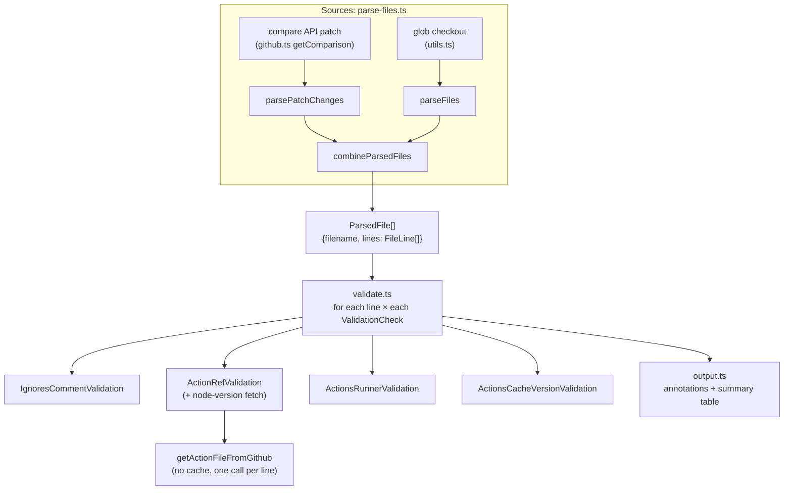
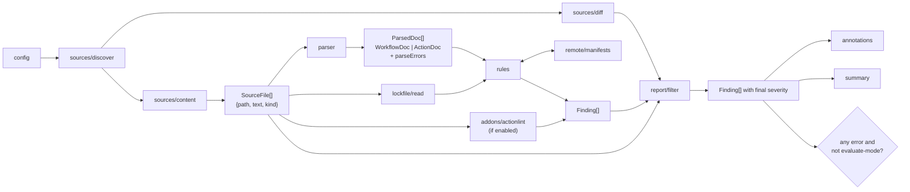
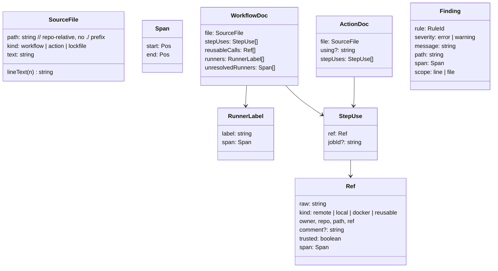
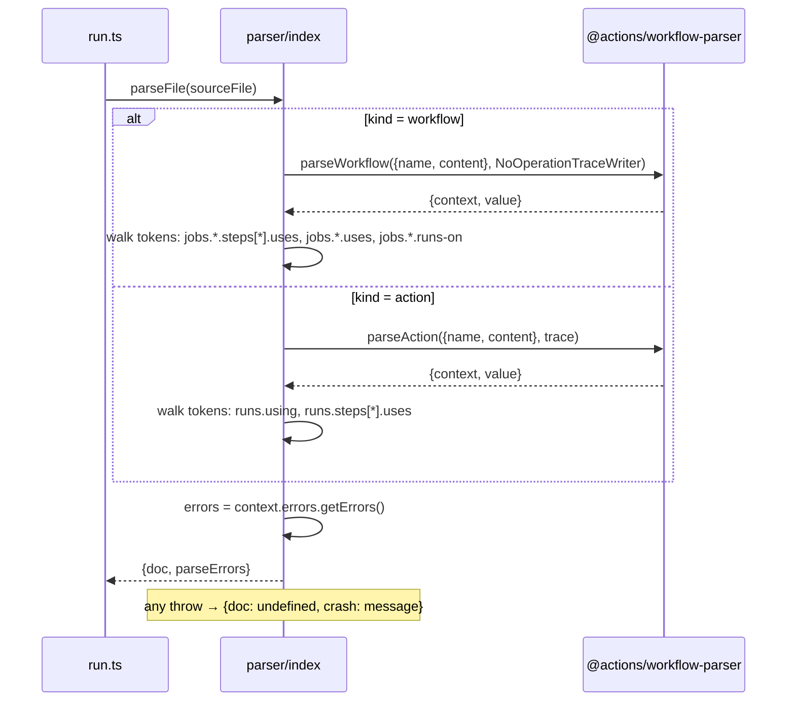
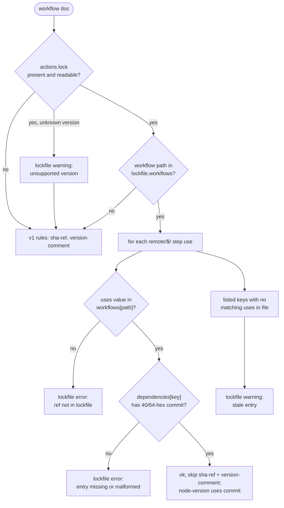
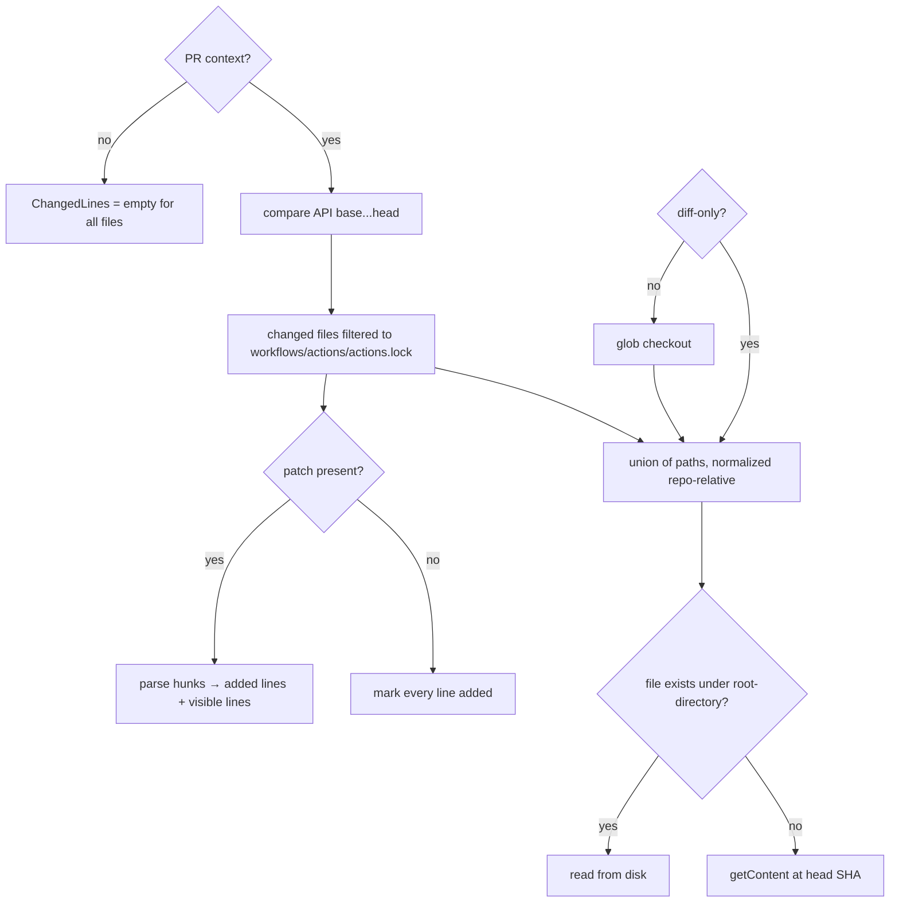
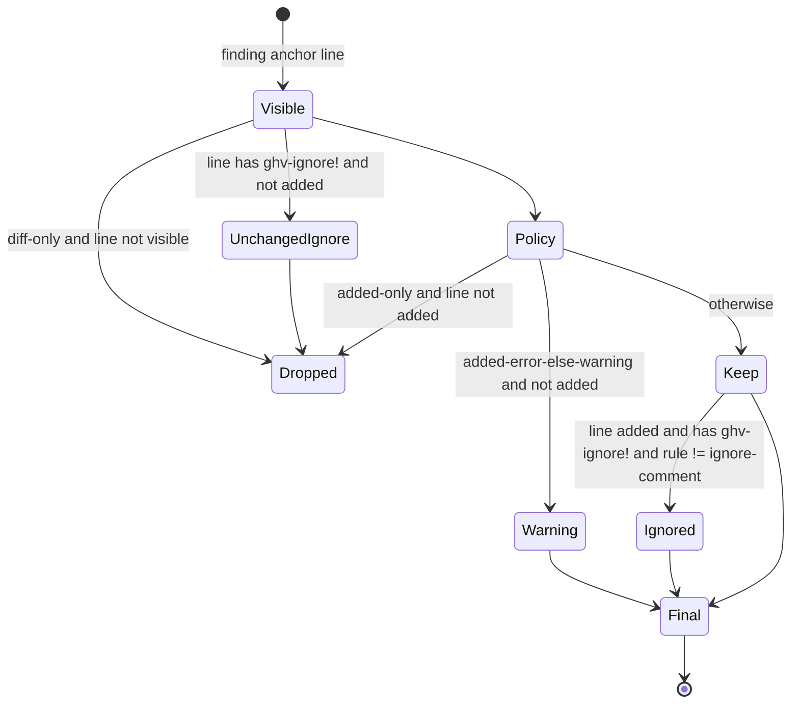
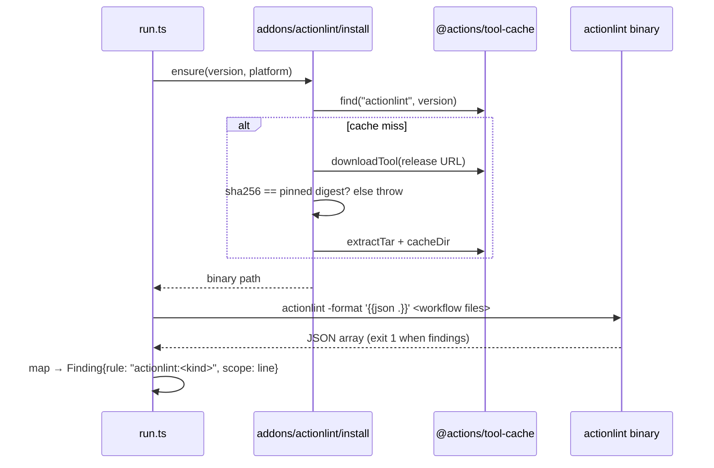

# Design: Rebuild gha-workflow-validator on the official Actions parser

## Context

The action lives in `actions/gha-workflow-validator/`. It is a `node24` action.
nx builds `src/index.ts` with esbuild into a committed CJS bundle at
`dist/index.js`. Tests run with vitest, and GitHub API calls are recorded with
nock fixtures under `src/__tests__/__fixtures__/`.

v1 has one data type at its core: a `FileLine` (`lineNumber`, `content`,
`operation: "add" | "unchanged"`, `ignored`). Everything turns into lines before
any rule runs.



### v1 behavior the rebuild must keep

These are the exact semantics of each rule today, read from the code. The parity
suite in Phase 2 pins them.

| Rule              | Fires on                                                             | Severity                             |
| ----------------- | -------------------------------------------------------------------- | ------------------------------------ |
| `ignore-comment`  | Added line containing `ghv-ignore!`                                  | error                                |
| `sha-ref`         | Added `uses:`, untrusted owner, ref not a full SHA                   | error                                |
| `version-comment` | Added `uses:`, untrusted owner, no `# ...` after the ref             | warning                              |
| `trusted-tag-ref` | Added `uses:`, trusted owner, ref is a full SHA                      | warning                              |
| `node-version`    | Added `uses:`, remote `action.yml` at that ref has `using: nodeN<24` | warning                              |
| `runner-ubuntu`   | Added `runs-on:` label, Ubuntu with 16 or more cores                 | error                                |
| `runner-macos`    | Added `runs-on:` label, macOS with 8 or more cores                   | error                                |
| `actions-cache`   | Any visible `uses: actions/cache…@ref`, ref not starting `v5`        | error if added, warning if unchanged |

Shared semantics:

- **Trusted owners** are `actions`, `github`, and `smartcontractkit`.
- **Skipped refs.** Local refs (`./…`, `$/…`) and reusable workflow refs (path
  ends in `.yml`/`.yaml`) get no ref rules.
- **Ignore.** A `ghv-ignore!` line that is unchanged is skipped entirely. On an
  added line, every other finding drops to severity `ignored`, and
  `ignore-comment` fires.
- **No PR.** Without `pull_request` base and head SHAs there is no diff, so
  every line is `unchanged`. Only `actions-cache` can fire, and only as a
  warning.
- **Inputs.** `evaluate-mode`, `root-directory`, `diff-only`,
  `validate-runners`, `validate-action-refs`, `validate-action-node-versions`,
  `validate-actions-cache-version`, `include-all-action-definitions`, plus
  `GITHUB_TOKEN` from env. `CL_LOCAL_DEBUG` accepts snake_case input env vars.

### v1 defects the rebuild fixes on purpose

The parity suite lists these as expected differences, not regressions.

- Quoted runner labels (`"ubuntu-latest-16cores"`), label arrays, and
  `{ group, labels }` runners are missed.
- Flow-style steps (`- { uses: … }`) are missed. `uses:` text inside `run: |`
  scripts is flagged.
- A file the compare API returns without a `patch` (large diffs) yields no lines
  and is never checked.
- The SHA-256 regex expects 256 hex characters. A SHA-256 commit ID is 64.
- `docker://image:tag` refs are parsed as owner `docker:` and produce
  `undefined is not a valid SHA reference`.
- Glob results carry a `./` prefix and compare API results do not, so the same
  file can appear twice in the merged list.
- `validate-action-node-versions` says "node 20" in `action.yml`. The rule
  checks 24.

### Parser facts from the spike

Spike against `@actions/workflow-parser@0.3.61`, bundled with the repo's esbuild
0.23 to CJS and run on Node 24.14:

- `parseWorkflow(file, trace)` and `parseAction(file, trace)` return
  `{ context, value }`. `parseAction` and `convertActionTemplate` come from the
  public subpath `@actions/workflow-parser/actions/index`, not the root export.
- Every token has a one-based `range: { start: { line, column }, end }`. `uses`
  is a `StringToken`; `runs-on` keeps its YAML shape (string, sequence, mapping,
  or expression token).
- Errors come from `context.errors.getErrors()`, each with `message` and
  `range`. Schema errors and YAML syntax errors both arrive this way.
- YAML comments are not in the token tree. Version comments and `ghv-ignore!`
  must be read from source text.
- `using: node26` fails the action schema. `convertActionTemplate` then returns
  `runs: undefined` by default, and `using: "composite", steps: []` with
  `errorPolicy: TryConversion`.
- Plain `node` cannot import the package (JSON import without
  `with { type: "json" }`). Bundled CJS works. Bundle size is about 620 KB.

### Lockfile facts

From GitHub's docs on workflow dependency lockfiles:

- One file, `.github/workflows/actions.lock`, YAML with `version`,
  `workflows: { <workflow path>: [<dep key>] }`, and
  `dependencies: { <dep key>: { ref, commit, owner_id, repo_id } }`. Dep keys
  look like `octo-org/deploy-action@v3.1.0`.
- A workflow is onboarded when its path is a key under `workflows`. For
  onboarded workflows the runner executes the locked `commit`. Step-level `uses`
  only; `jobs.<id>.uses` is not covered.
- `./` local actions are not locked. `$/` actions are.
- `gh actions-lock --verify` detects staleness, including moved tags, using the
  network.

## Approach

### Module layout

```text
src/
  index.ts                 entry, calls run()
  run.ts                   orchestration only
  config.ts                inputs + invoke context (v1 getInputs/getInvokeContext)
  sources/
    discover.ts            which files to check (repo glob, PR file list)
    content.ts             file text: checkout first, else API at head SHA
    diff.ts                patch → ChangedLines per file
  parser/                  the only importer of @actions/workflow-parser
    index.ts               parseFile(SourceFile) → ParsedDoc
    workflow.ts            token tree → WorkflowDoc
    action.ts              token tree → ActionDoc
    remote-manifest.ts     action.yml text → { using?: string }
  model.ts                 Span, Ref, RunnerLabel, WorkflowDoc, ActionDoc, Finding
  refs.ts                  parse "owner/repo/path@ref" + trailing comment
  lockfile/
    read.ts                actions.lock text → Lockfile | LockfileProblem
  remote/
    manifests.ts           fetch + memoize remote action.yml by owner/repo/path@commit
  rules/
    index.ts               registry, input toggles
    action-refs.ts         sha-ref, version-comment, trusted-tag-ref
    node-version.ts
    runners.ts             runner-ubuntu, runner-macos
    actions-cache.ts
    ignore-comment.ts
    lockfile.ts
    schema.ts              parser errors → findings
  addons/actionlint/
    install.ts             download + sha256 verify + tool-cache
    run.ts                 invoke, parse JSON → Finding[]
  report/
    filter.ts              diff + ignore + severity policy
    annotations.ts
    summary.ts
    strings.ts             FIXING_ERRORS help text
```

The rule: nothing outside `parser/` imports `@actions/workflow-parser`, and
nothing in `rules/` touches raw text except through `SourceFile.lineText(n)`. A
lint rule (`no-restricted-imports`) enforces the first half.

### Pipeline



Rules produce every finding they can see. Only `report/filter` decides what the
diff hides and what `ghv-ignore!` downgrades. That keeps rules free of diff
logic, which is where v1's per-rule `operation === "unchanged"` checks lived.

### Model



`Ref` is built by `refs.ts` from the `uses` token's value plus the source line
text after the token's end column (for the `# vX.Y.Z` comment). That one parser
replaces v1's `extractActionReferenceFromLine` and handles quoting for free,
since the token value is already unquoted.

`kind` rules: `./` and `$/` → `local`; `docker://` → `docker`; a path ending in
`.yml`/`.yaml` → `reusable`; else `remote`. Ref rules act only on `remote`.

### Parser seam



Decisions:

- **Walk tokens, do not convert.** The adapter walks the `TemplateToken` tree by
  key (`jobs` → each job → `steps` → each step → `uses`). It does not call
  `convertWorkflowTemplate` or `convertActionTemplate`. Conversion is async,
  skips on any error by default, and returns wrong data when forced (see spike).
  The walk tolerates schema errors because the tree exists whenever the YAML
  parses.
- **Runners.** `runs-on` string → one label. Sequence → each string item.
  Mapping → its `labels` (string or sequence); `group` alone is ignored.
  Expression or anything else → `unresolvedRunners`, logged at debug. Static
  matrix expansion is a follow-up, not v2.0.
- **Remote manifests** (`remote-manifest.ts`) also go through `parseAction` and
  read `runs.using` from the token tree, so `node26` reads as `node26`, not as
  an error. If the YAML does not parse, return `{}` and log a warning, matching
  v1's "no action file found" path.
- **Crash isolation.** Each file is parsed in its own `try`. A throw yields an
  `internal-error` finding (error, scope `file`) on that path and the run
  continues with other files.
- **Pin.** `package.json` lists `"@actions/workflow-parser": "0.3.61"` with no
  range. esbuild bundles it; `dist/index.js` has no runtime dependency on it.

### Rules

Each rule is a plain function:

```ts
type Rule = {
  id: RuleId;
  enabled: (cfg: Config) => boolean;
  check: (doc: ParsedDoc, ctx: RuleContext) => Promise<Finding[]>;
  policy: "added-only" | "added-error-else-warning" | "file";
};
type RuleContext = {
  lockfile?: Lockfile;
  manifests: ManifestCache;
  cfg: Config;
};
```

`policy` carries what v1 encoded inside each rule: when a finding counts given
the line's diff status. `report/filter` applies it.

| Rule              | Input                             | Policy                                       | Notes                                                    |
| ----------------- | --------------------------------- | -------------------------------------------- | -------------------------------------------------------- |
| `sha-ref`         | `stepUses` (remote)               | added-only                                   | Skipped for onboarded workflows (see lockfile)           |
| `version-comment` | `stepUses` (remote)               | added-only                                   | Skipped for onboarded workflows                          |
| `trusted-tag-ref` | `stepUses` (remote)               | added-only                                   | Unchanged                                                |
| `node-version`    | `stepUses` (remote)               | added-only                                   | Fetches at locked `commit` when onboarded, else at `ref` |
| `runner-ubuntu`   | `runners`                         | added-only                                   | v1 label regexes, unchanged                              |
| `runner-macos`    | `runners`                         | added-only                                   | v1 label regexes, unchanged                              |
| `actions-cache`   | `stepUses` where `actions/cache*` | added-error-else-warning                     | Unchanged                                                |
| `ignore-comment`  | `SourceFile` lines                | added-only                                   | Text scan; the one rule that reads lines                 |
| `lockfile`        | `stepUses` + lockfile             | file                                         | New                                                      |
| `schema`          | `parseErrors`                     | added-error-else-warning → capped at warning | New; never an error in v2.0                              |
| `internal-error`  | parser crash                      | file                                         | New; always error                                        |

`sha-ref` accepts `/^[0-9a-f]{40}$/` or `/^[0-9a-f]{64}$/`.

Step uses inside `ActionDoc` (composite actions) get the same ref rules as
workflows. v1 already checked them as lines.

### Lockfile



- `lockfile/read.ts` parses YAML with the `yaml` package (already pulled in by
  the parser) and validates shape by hand. Known versions: `v0.0.3`. An unknown
  version is treated as no lockfile plus one warning. That is the strict
  fallback: v1 SHA rules apply.
- The lookup key is the step's `uses` value as written, matching the docs'
  dep-key format. Reusable workflow calls are never exempt.
- **Severity under diff.** Lockfile findings use scope `file`. In a PR they are
  errors if the workflow file or `actions.lock` changed, and warnings otherwise.
  Without a PR they are warnings. They anchor on the `uses` span (or line 1 of
  `actions.lock` for stale entries) so annotations land where the fix goes.
- **Not checked here:** moved tags, rewritten history, and `owner_id`/`repo_id`
  drift. Those need the network and are what `gh actions-lock --verify` does.
  The README tells adopters to run GitHub's verify workflow as well.
- **Discovery.** `actions.lock` is always read from the checkout or the API at
  head, even in `diff-only` mode, because exemptions depend on it.
- New input `validate-lockfile` (default `true`). When `false`, the lockfile is
  ignored and v1 rules apply everywhere.

### Sources and the diff



- **Content.** v2 needs full file text to parse, even in `diff-only` mode. v1's
  README example has no checkout step and v1 still worked from patches alone. To
  keep that working, `content.ts` reads from disk when the file exists, else
  fetches it at the head SHA. Fetches are memoized and capped at 8 in flight.
- **ChangedLines** per path: `added: Set<number>` and `visible: Set<number>`
  (added plus patch context lines). In full-scan mode every line is visible.
- **Paths** are repo-relative with no `./` prefix everywhere, which removes v1's
  duplicate-file bug.

### Filter and severity



- The anchor line is `span.start.line`. A multi-line `uses` token is rare and
  its first line is where the comment would go.
- `file`-scope findings skip the visibility and `added-only` checks but still
  honor `ghv-ignore!` on their anchor line.
- `schema` findings are clamped to warning after the policy step.
- `evaluate-mode` is applied last, in `run.ts`, exactly as in v1.

### actionlint add-on



- **Build.** Upstream `rhysd/actionlint`, one version pinned in
  `addons/actionlint/versions.ts` with sha256 for `linux_amd64`, `linux_arm64`,
  `darwin_amd64`, and `darwin_arm64`. Same engine as the lefthook hook and
  `ci-lint-misc`, so a developer sees the same result locally. The kjanat fork
  is a second entry in the same table later; its JSON shape differs, so `run.ts`
  maps by build.
- **Input** `actionlint: off | warn | error`, default `off`. `warn` clamps every
  actionlint finding to warning. `error` keeps errors as errors.
- **Scope.** Only workflow files. Upstream actionlint does not lint
  `action.yml`.
- **Policy** `added-only`, so a repo that turns it on is not flooded by existing
  findings. In full-scan mode existing findings show as warnings.
- **ShellCheck** runs if it is on `PATH`, which is actionlint's default. It is
  on GitHub's Ubuntu images. The trial period measures this noise.
- **Failure.** Download, checksum, or exit codes other than 0 and 1 produce one
  `actionlint` warning (not error) and the run continues. The add-on never
  blocks the core rules.

### Inputs (v2)

All v1 inputs keep their names and defaults. New:

| Input               | Default | Meaning                                            |
| ------------------- | ------- | -------------------------------------------------- |
| `validate-lockfile` | `true`  | Honor `actions.lock` exemptions and run `lockfile` |
| `validate-schema`   | `true`  | Report parser schema errors as warnings            |
| `actionlint`        | `off`   | `off`, `warn`, or `error`                          |

`GITHUB_TOKEN` stays an env var for compatibility. `config.ts` also accepts an
optional `github-token` input that wins when set, so callers can move to an
explicit input.

### Rejected options

- **Run v1 and v2 side by side in one action.** Doubles the code and the help
  text, and the line model is the thing we are removing.
- **Call `convertWorkflowTemplate` and walk the typed model.** Cleaner types,
  but it hides every token when any schema error exists. See the spike.
- **Shell out to `gh actions-lock --verify` for the lockfile rule.** Needs the
  `gh` extension installed in every caller, a token with the right scope, and
  network calls per ref. Repos that want that should run GitHub's verify
  workflow, which is designed for it.
- **Required actionlint.** Covered in the proposal.

## Verification

Standard: `pnpm nx run gha-workflow-validator:test`, `:check-types`, `:build`,
and `pnpm lint:affected`.

Behavioral checks:

- **Parity suite.** v1's fixture inputs (the fake repo, recorded compare
  responses, and the action-ref line cases) run through v2. Findings are
  normalized to `(path, line, rule, severity)` and compared to v1's snapshots.
  Every difference must be on the expected-differences list in Context. Kept
  until v1 code is deleted in Phase 3, then frozen as golden snapshots.
- **Shape corpus.** One fixture per YAML shape: quoted and unquoted `uses`,
  flow-style steps, `uses:` inside `run: |`, `runs-on` as string, quoted string,
  sequence, `{group, labels}`, and expression; reusable calls; `./`, `$/`, and
  `docker://` refs; composite, node, and docker manifests; `node12` through
  `node26`; a schema error; a YAML syntax error. Snapshot the adapter output.
- **Real-world corpus.** Every `.github/workflows/*.yml`, `workflows/*/*.yml`,
  and `actions/*/action.yml` in this monorepo runs through the adapter in a
  test. Assert no crashes, and snapshot the count of step uses and schema errors
  per file. A parser upgrade that changes these fails the test.
- **Bundle smoke.** `scripts/test.sh` runs the built `dist/index.js` with
  `CL_LOCAL_DEBUG` against the fake repo. This proves the bundled parser loads
  under plain Node 24, which the spike showed the unbundled package does not.
- **Lockfile scenarios.** Onboarded workflow with `@v4` refs all listed → no
  `sha-ref`. One ref missing → `lockfile` error. Lockfile lists a ref the
  workflow dropped → warning. Workflow not in `workflows` → v1 rules. Unknown
  `version` → warning plus v1 rules. Reusable call in onboarded workflow → still
  skipped like v1. `node-version` fetch hits the locked commit (assert the nock
  path).
- **Diff scenarios.** File with no `patch` → all findings count as added. PR
  with no checkout (`root-directory` empty) → content fetched at head. Push
  event → only warnings. `ghv-ignore!` added vs unchanged.
- **actionlint.** Checksum mismatch → one warning, core findings unaffected.
  Fake binary (shell script printing canned JSON) for mapping tests. One real
  run in CI on the fake repo with `actionlint: warn`.
- **Dogfood.** Before the major tag, point this repo's own validator workflow at
  the branch build in `evaluate-mode` for one week and compare its summary
  against v1 on the same PRs.

## Risks

- **Parser schema lags GitHub.** New syntax produces `schema` warnings on valid
  workflows. Contained: warnings only, and rules walk tokens rather than
  trusting the converter. Noticed through user reports and the dogfood summary.
- **Parser crashes on a real file.** Fails closed with `internal-error`, which
  blocks that PR. Noticed immediately; `evaluate-mode` unblocks while we patch
  via `pnpm patch` or bump.
- **Parser abandonment.** No releases since August 2026 and no outside PRs. The
  seam keeps the blast radius to `parser/`. A fallback adapter over the `yaml`
  package's own position-carrying nodes is the plan if we must leave.
- **Lockfile format changes.** It is at `v0.0.3` and the docs do not state GA
  status. Unknown versions fall back to v1 rules, which is strict, so the
  failure mode is extra errors, not missed ones. Noticed through the
  unsupported-version warning.
- **Lockfile exemption is too loose.** If our structural check passes but the
  lockfile is stale in a way only the network can see, a moved tag could slip
  through review. The runtime still executes the locked commit, so what runs is
  what was locked; the gap is review visibility, not execution. Documented, and
  adopters are told to run `gh actions-lock --verify`.
- **Content fetch cost.** v2 fetches full files where v1 used patches. A PR
  touching many workflows makes more API calls. Capped concurrency and
  memoization keep it bounded; a rate-limit error surfaces as a warning per file
  plus `internal-error`, so it fails closed.
- **actionlint noise.** Off by default. If teams turn it on and drown, they turn
  it off; it cannot fail a build unless set to `error`.
- **Behavior drift hidden in a rewrite.** The parity suite with an explicit
  expected-differences list is the guard. Any unlisted diff fails CI.

## TODO

Effort: hard (rebuilds supply-chain enforcement on a new parse model while
preserving subtle diff, ignore, and trust semantics across many modules)

### Phase 1: Parser seam and model

Effort: medium (one new module behind a clear interface, verified by corpus
snapshots; no behavior change yet)

- [ ] Add `@actions/workflow-parser@0.3.61` (exact pin), `model.ts`, `refs.ts`,
      and `parser/` (workflow, action, remote-manifest) walking tokens into
      `WorkflowDoc`/`ActionDoc` with spans, crash isolation, and parse errors;
      cover with the shape corpus snapshot tests and a `no-restricted-imports`
      rule keeping the package inside `parser/`.
- [ ] Add the real-world corpus test over this monorepo's workflows and action
      manifests, and extend `scripts/test.sh` with a bundle smoke that imports
      the parser through the built `dist/index.js`.

### Phase 2: Rules and filter at v1 parity

- [ ] Port `sha-ref`, `version-comment`, `trusted-tag-ref`, `node-version`
      (token-based `using`, memoized `remote/manifests.ts`), `runner-ubuntu`,
      `runner-macos`, `actions-cache`, and `ignore-comment` as `Rule`s over the
      model, plus `schema` and `internal-error`, with unit tests per rule
      including the fixed v1 defects.
- [ ] Build `sources/diff.ts` and `report/filter.ts` (visibility, policy,
      ignore, schema clamp) and the parity suite that runs v1 fixtures through
      v2 and compares normalized findings against v1 snapshots with the
      expected-differences list.

### Phase 3: Cut over to v2

Effort: medium (wiring and I/O against established interfaces, with the parity
suite as the safety net)

- [ ] Replace `run.ts` with the v2 pipeline: `config.ts` (v1 inputs plus
      `validate-schema` and optional `github-token`), `sources/discover.ts`,
      `sources/content.ts` with API fallback at head SHA,
      `report/annotations.ts` and `report/summary.ts` with updated help text;
      delete the v1 line-model modules and freeze the parity results as golden
      snapshots; update `action.yml` input descriptions and the README.

### Phase 4: Lockfile support

- [ ] Add `lockfile/read.ts`, the `lockfile` rule, onboarded-workflow exemptions
      for `sha-ref` and `version-comment`, and locked-commit fetches for
      `node-version`, behind the new `validate-lockfile` input, with the
      lockfile scenarios from Verification; document adoption and
      `gh actions-lock --verify` in the README and help text.

### Phase 5: actionlint add-on

Effort: medium (self-contained subprocess integration with a pinned download and
a JSON mapping)

- [ ] Add `addons/actionlint/` (pinned upstream version table with sha256 per
      platform, tool-cache install, JSON mapping to findings) behind the
      `actionlint` input with `off` default, failure-as-warning behavior, fake
      binary tests, and one real CI run on the fake repo; document the input and
      trial plan in the README.

### Phase 6: Release v2

Effort: easy (changeset and docs that follow the repo's existing release
pattern)

- [ ] Add a major changeset for `gha-workflow-validator` with a migration note
      (new inputs, fixed v1 defects that may surface new findings, lockfile
      behavior) and run the dogfood comparison in `evaluate-mode` before
      merging.
