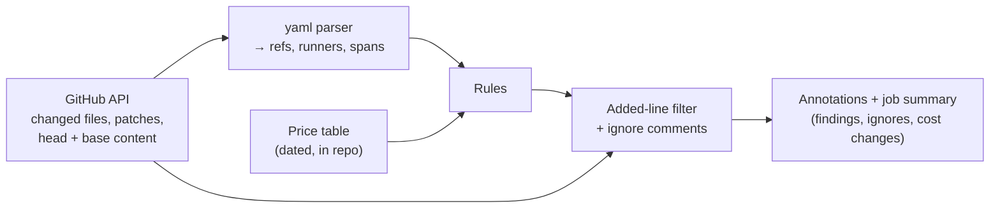

# gha-workflow-validator v2: a small, strict, org-wide gate

## Goal

Stop a PR from adding supply-chain risk or avoidable runner cost to any workflow
in the org, without blocking PRs that add neither.

This check is required on most org repos, and we want it required on all of
them. That sets four constraints:

1. **Precision beats recall.** A false positive blocks merges across the org. A
   miss lets one bad line through review. When in doubt, don't fire.
2. **No moving parts we don't own.** No upstream linter release, binary
   download, or per-action network lookup decides whether a PR can merge.
3. **Judge only what the PR adds.** Existing debt never blocks an unrelated PR.
4. **Every finding says how to fix it.** Every error that can be legitimate has
   one way past it, and reviewers can see it.

## Context

v1 reads workflows as lines of text and guesses what each line means with
regexes. The guessing causes the bugs we know about:

- `runs-on: "ubuntu-latest-16cores"` (quoted), label arrays, and
  `{ group, labels }` runners skip the cost check.
- `uses: foo@main` inside a `run: |` script is flagged as an unpinned action.
- A file the compare API returns without a patch (large diffs) is never checked.
- Reusable workflow calls (`jobs.<id>.uses`) are never checked, so a third-party
  workflow at `@main` passes.
- The bypass comment, `ghv-ignore!`, downgrades other findings but raises its
  own error, so it doesn't actually get you past the check.

Some v1 rules have outlived their reason. `actions-cache` enforced a one-time
move to `actions/cache@v5`. `node-version` fetches every referenced `action.yml`
over the network to warn about old Node runtimes, which GitHub already warns
about in run logs.

The action has one caller: the org-wide workflow in `gha-org-workflows`, which
runs on `pull_request` and `merge_group`. So v2 is free to break inputs, rule
names, and output. Migration means updating that one workflow.

## Rules

Every rule looks only at lines the PR adds. Trusted owners are `actions`,
`github`, and `smartcontractkit`.

| Rule              | Fires when an added line…                                                                     | Severity      | Ignorable | Fix                                                                  |
| ----------------- | --------------------------------------------------------------------------------------------- | ------------- | --------- | -------------------------------------------------------------------- |
| `pinned-ref`      | uses a third-party action or reusable workflow at a ref that is not a full commit SHA         | error         | yes       | Pin to the full SHA and add `# vX.Y.Z`                               |
| `version-comment` | pins a third-party ref to a SHA with no version comment                                       | warning       | yes       | Add the tag the SHA points at, e.g. `# v4.2.2`                       |
| `internal-ref`    | pins a `smartcontractkit` ref to a SHA                                                        | warning       | yes       | Use the tag (`@v1`) so moved major tags reach you                    |
| `docker-digest`   | uses a `docker://` image without an `@sha256:` digest                                         | warning       | yes       | Pin by digest                                                        |
| `runner-cost`     | picks a GitHub-hosted runner that costs more than the standard Linux runner                   | warning/error | yes       | Use RunsOn. Only if RunsOn can't work, use a larger GitHub runner.   |
| `yaml-syntax`     | is in a changed file that does not parse as YAML                                              | error         | no        | Fix the YAML                                                         |
| `ignore-syntax`   | has an ignore comment with no rule, an unknown rule, no reason, or the old `ghv-ignore!` form | error         | no        | Write `# ghv-ignore: <rule> <reason>`                                |
| `unused-ignore`   | has an ignore comment that suppresses nothing                                                 | warning       | no        | Remove it                                                            |
| `internal-error`  | is in a file the validator could not fetch or parse                                           | error         | no        | Re-run. If it persists, report it; `evaluate-mode` unblocks the org. |

### Runner cost

`runner-cost` grades a runner by its per-minute price against the standard
2-core Linux runner ($0.006/min):

| Runner                                | Severity | Examples                                           |
| ------------------------------------- | -------- | -------------------------------------------------- |
| At or below standard Linux            | none     | `ubuntu-latest`, `ubuntu-slim`, `ubuntu-24.04-arm` |
| Above standard, under $0.042/min (7×) | warning  | `ubuntu-latest-4cores`, `windows-latest`           |
| $0.042/min or more                    | error    | `ubuntu-latest-16cores`, `windows-latest-8cores`   |
| Standard macOS                        | warning  | `macos-latest` (RunsOn has no macOS)               |
| Larger macOS                          | error    | `macos-latest-large`, `macos-latest-xlarge`        |
| RunsOn, self-hosted, or unresolved    | none     | `runs-on=${{ github.run_id }}/cpu=16/...`          |

$0.042/min is where v1 errors today (16-core Linux), so v2 doesn't loosen the
existing gate.

Each finding shows simple cost estimates and tells people what to do, in order:

1. Use our [RunsOn integration](https://github.com/smartcontractkit/runs-on) for
   cheaper, more powerful Linux and Windows runners.
2. Only if RunsOn can't work for this job, keep the GitHub runner and say why
   with `# ghv-ignore: runner-cost <reason>`.

For example:

```text
runner-cost: ubuntu-latest-16cores costs $0.042/min ($2.52/hr), 7× the standard runner.
Use RunsOn first: a 16-CPU latest-generation RunsOn runner costs about $0.0125/min on-demand, 3.4× cheaper.
On-demand price. Spot instances can cut this by about 2.5×.
  runs-on: runs-on=${{ github.run_id }}/cpu=16/image=ubuntu24-full-x64
Pick the latest EC2 generation for `family=` (today: 9 for arm64, 8 for x64).
Only if RunsOn can't work for this job, keep this runner and add:
  # ghv-ignore: runner-cost <why RunsOn doesn't work>
```

The job summary also lists every runner the PR changes, with its per-minute cost
before and after and the RunsOn equivalent. People see what a change costs
before it merges.

Estimates come from a dated price table in the action, sourced from GitHub's
runner pricing and AWS on-demand rates for the latest EC2 generation. They are
list prices per minute, not a bill. The table is refreshed by PR.

We recommend the latest EC2 generation, not a fixed family, so the advice stays
current as AWS ships new instances. Today that's generation 9 for arm64
(Graviton) and generation 8 for x64, because AWS has no x64 generation 9 yet.
The messages will link to RunsOn family guidance in the `runs-on` repo once it
exists.

### Ignoring a finding

One form, on the same line as the finding:

```yaml
runs-on: ubuntu-latest-32cores # ghv-ignore: runner-cost perf baseline must match GitHub hardware
```

The comment names the rule and gives a reason. That rule's finding on that line
becomes an "ignored" entry in the job summary, along with the reason, and blocks
nothing. The control is review. The comment is an added line in the diff, so the
PR's reviewers approve the bypass together with the code, and the summary lists
every ignore so none slips by.

Malformed or blanket ignores (`ghv-ignore!`) fail the check. An ignore that
suppresses nothing is a warning, so stale ignores don't pile up.

## Decision

Rewrite the action from scratch as v2. Parse each changed workflow and
`action.yml` with the `yaml` package, which gives line and column for every
node. The rules are small functions over a small model: refs and runner labels,
each with a position. The diff only decides which findings count.



**Why `yaml`, not `@actions/workflow-parser`.** The official parser adds two
things over plain YAML: schema validation and expression parsing. This check
needs neither. Schema checks are a correctness lint, and the parser's schema
already lags GitHub (it rejects `using: node26`). The parser also brings real
costs:

- It is pre-1.0, with no release since August and no outside PRs.
- It drops YAML comments, which this check needs.
- It won't load in plain Node 24 without bundling workarounds.

`yaml` is stable (2.x), keeps positions, and is already in our dependency tree.
v2 reads five paths: `jobs.*.steps[*].uses`, `jobs.*.uses`, `jobs.*.runs-on`,
`runs.using`, and `runs.steps[*].uses`. A full workflow model isn't worth a
pre-1.0 dependency in a required gate.

**Why no actionlint.** It catches real bugs our rules never will: expression
types, ShellCheck on `run:`, and bad `needs`. It still doesn't belong in a
required org gate:

- We don't own its rules, so a release can turn green repos red overnight. The
  kjanat fork's v1.17.0 notes say its new defaults "can make previously clean
  workflows exit with status 1", and the fork has one maintainer.
- It adds a binary download and checksum to a check that must not flake.
- It is a correctness lint, not a security or cost policy. Repos already run it
  through lefthook and `ci-lint-misc`.

If we want it org-wide, run it as its own non-required job in the org workflow.
That needs no new action and keeps its noise out of the merge decision.

**Why no lockfile support.** GitHub's
[workflow dependency lockfiles](https://docs.github.com/en/actions/concepts/security/workflow-dependency-lockfiles)
lock each step's `uses` to a commit. That clashes with how we ship internal
actions: moving major tags (`@v1`) are how updates reach the org. A lockfile
freezes `@v1` at the locked commit, so a moved tag never reaches the repo. It
also makes it harder to tell which version a repo runs. SHA-pinning third-party
refs already covers most of what lockfiles protect against.

v2.0 neither reads nor rejects lockfiles. A repo with one still needs SHA pins
on third-party refs, and SHA pins and a lockfile work fine together.

v2 is built so lockfile support can be added later without reworking it. That
would be one new file kind, one new rule, and one new answer from the function
that decides whether a ref is pinned. The design's "Room for lockfile support"
section lists those seams. Before that work starts, the org needs a separate
decision on how lockfiles coexist with moving major tags on internal actions.

## Non-goals

- Making the check required in the repos that skip it today. That's an org
  ruleset change. v2's job is to be quiet and correct enough that requiring it
  everywhere is an easy call.
- Full-repo audits. Without a diff, v2 does nothing. A scheduled audit across
  the org would be a separate tool.
- Pinning `container:` and `services:` images, action allowlists, and checking
  that a SHA matches its version comment. Each is easy on v2's model and gets
  its own proposal.
- Keeping v1's inputs, rule names, or output format.

## Migration

The org workflow is the only caller.

1. Release v2 as a major version of `gha-workflow-validator`.
2. In `gha-org-workflows`, add v2 as a second, non-required job with
   `evaluate-mode: true`. Run both for one week and compare their summaries on
   the same PRs.
3. Point the required job at v2 and delete the v1 job.

## Why `hard`

This is supply-chain enforcement that every org repo must pass. The rules are
simple, but the edges are not: mapping diff lines to YAML nodes, ignore
semantics, files without patches, and failing closed. A shallow rewrite would
hide regressions in exactly those places.
