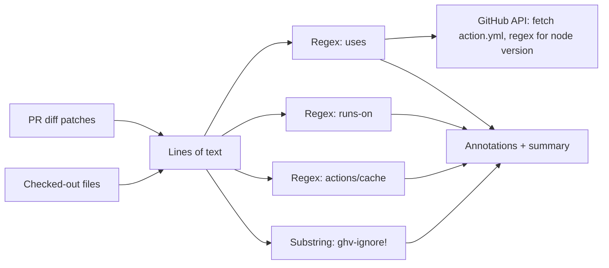
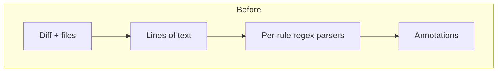
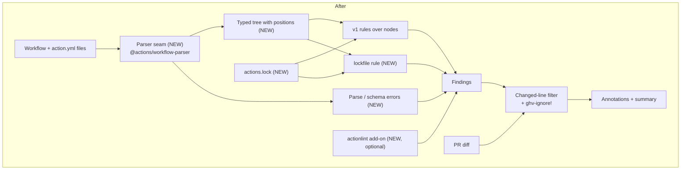
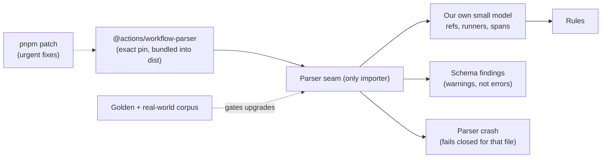

# Rebuild gha-workflow-validator on the official Actions parser

## Context

`gha-workflow-validator` reads workflows as lines of text, not as YAML. Each
rule gets one line at a time and decides what it means with string prefixes and
regexes. A line is a `uses:` reference if it starts with `uses: ` or `- uses: `.
A line is a runner if a regex finds `runs-on`. The diff side works the same way:
the action pulls patches from the compare API and maps changed lines back to
rules.

This works for the common case, but it guesses, and it guesses wrong in ways
that are easy to hit:

- **False negatives.** A quoted runner such as
  `runs-on: "ubuntu-latest-16cores"` slips past the cost check: the parser sees
  the quote and gives up with a warning. Flow-style YAML, `runs-on` label
  arrays, and other valid shapes go unchecked for the same reason.
- **False positives.** A line inside a `run: |` script that happens to start
  with `uses: foo@main` is flagged as an unpinned action.
- **Silent gaps.** When GitHub omits a file's patch (large diffs), that file
  yields no changed lines and is not checked.
- **No structural checks.** A workflow with a typo in a key or a broken
  expression passes, because nothing parses it.
- **Fragile to extend.** Every new rule writes its own text parser. The README's
  wish list (local action refs, verifying the SHA matches the tag comment, an
  action allowlist) all need real structure, which today's model cannot give.

GitHub publishes the parser its own editor tooling uses:
`@actions/workflow-parser` in
[actions/languageservices](https://github.com/actions/languageservices) (MIT,
v0.3.61). It turns workflows and `action.yml` files into a typed tree, validates
them against GitHub's workflow schema, and keeps a line and column on every
node.

GitHub has also added
[workflow dependency lockfiles](https://docs.github.com/en/actions/concepts/security/workflow-dependency-lockfiles).
A machine-generated `.github/workflows/actions.lock`, maintained by
`gh actions-lock` and Dependabot, pins every step-level action (transitive deps
included) to a commit SHA, plus the owner and repo IDs. GitHub's docs say SHA
pinning in workflow files is "no longer necessary" for workflows onboarded to
it. v1 knows nothing about lockfiles. It flags `@v4` on an onboarded workflow as
an error even though the locked commit is what runs, and it never checks that
the lockfile is present or current. The lockfile does not cover reusable
workflow calls (`jobs.<id>.uses`) or workflows that are not onboarded. Those
still need SHA pins.

Separately, [actionlint](https://github.com/rhysd/actionlint) already runs here
in two places: the lefthook pre-commit hook and `ci-lint-misc`.
[kjanat/actionlint](https://github.com/kjanat/actionlint) is an active fork that
adds `action.yml` validation, cache-safety policies, a versioned JSON result
schema, SARIF output, and attested releases.

## Goals and non-goals

**Why now.** Lockfiles make v1's central rule wrong for any repo that adopts
them, and fixing that on the line model means another hand-written parser. The
rest of the rule set is stable and small, so a rebuild is cheap compared to its
payoff. An official parser now exists that removes the guessing.

**Success looks like:**

- Every v1 rule keeps its meaning, name, and severity: `sha-ref`,
  `version-comment`, `trusted-tag-ref`, `node-version`, `runner-ubuntu`,
  `runner-macos`, `actions-cache`, and `ignore-comment`.
- Rules read typed nodes (a step's `uses`, a job's `runs-on`), never raw lines.
  The known false positives and negatives above become regression tests and
  pass.
- Diff mode still reports only on changed lines, and a file with a missing patch
  is checked in full, not skipped.
- Lockfile-aware pinning. For a workflow listed in `actions.lock`, step-level
  refs may use tags. `sha-ref` and `version-comment` step aside for them, and a
  new `lockfile` rule fails if a ref in the workflow is missing from the
  lockfile or does not match it. Workflows not onboarded keep the v1 SHA rules
  unchanged. `node-version` checks the locked commit, not the tag.
- Parse and schema errors show up as annotations instead of passing silently.
- actionlint can run as part of the same check, with its findings in the same
  annotations and summary.
- Callers move by bumping the tag. Inputs stay compatible where they still make
  sense.

**Non-goals:**

- New policy rules beyond `lockfile`. The README wish list (allowlist,
  SHA-to-tag verification, local refs) becomes easy after this, but each one is
  its own proposal. The same goes for requiring SHA pins on reusable workflow
  calls, which v1 skips.
- Generating or updating lockfiles. `gh actions-lock` and Dependabot own that;
  we only read and check.
- Requiring repos to adopt lockfiles. That is an org Actions policy ("Require
  lockfile"), not this check's job.
- Changing the `ghv-ignore!` syntax or the bypass process.
- Replacing `ci-lint-misc` or the lefthook actionlint hook.
- Migrating callers. v1 stays on its tags; repos opt in to v2.

## Decision

Rebuild the action in TypeScript on `@actions/workflow-parser`. Files go through
one parser seam that returns a typed tree with positions. Rules become small
functions over that tree. The diff only decides which findings to keep; it no
longer decides what the code means. The lockfile is a second input next to the
tree: it tells the pinning rules which workflows are already covered and gives
`node-version` the commit to check. actionlint becomes an optional add-on scan,
off by default in v2.0.

**TypeScript vs Go.** TypeScript wins, mainly because the official parser only
exists in TypeScript.

|                    | TypeScript                                              | Go                                                                  |
| ------------------ | ------------------------------------------------------- | ------------------------------------------------------------------- |
| Official parser    | Yes, `@actions/workflow-parser`, direct import          | None from GitHub. Would mean actionlint's parser or our own         |
| Fit with this repo | Matches the nx, esbuild, and committed `dist/` setup    | New build, release, and binary-download path for a composite action |
| Runtime            | Runs as `node24`, no download step                      | Needs a per-platform binary fetched and verified at run time        |
| actionlint         | Shells out to a pinned binary                           | Could link actionlint as a library and share one parse              |
| Speed              | Plenty for tens of files per PR                         | Faster, but speed is not the problem                                |
| Risk               | Parser is pre-1.0, and GitHub is not taking outside PRs | Parser fidelity drifts from GitHub's own behavior                   |
| Packaging          | Needs a bundler to load (see below); we already bundle  | Static binary                                                       |

Go's best case is to embed actionlint and use its parser for everything. That
trades the official parser for a third-party one, which defeats the first goal.

**Living with a pre-1.0 parser.** A spike against v0.3.61 found three concrete
hazards, beyond the version number:

- **Schema lag.** The bundled schemas are GitHub's guess at valid YAML, frozen
  at release time. The action schema already rejects `using: node26`. With no
  release since August and no outside PRs, new syntax will reach real workflows
  before it reaches the parser.
- **Wrong data on invalid input.** When a manifest fails the schema, the typed
  converter returns nothing by default. Told to convert anyway, it returned
  `using: composite` with no steps for a `node26` action, which is wrong, not
  just missing.
- **Packaging.** The package imports its schema JSON without the import
  attribute Node 24 requires, so it does not load in plain Node. It works once
  bundled by esbuild, which this repo already does.

We contain these instead of waiting for 1.0:

- **One seam.** Only the adapter imports the package. Rules see our own small
  model, so a broken release, a fork, or a fallback YAML walker changes one
  module, not every rule.
- **Exact pin, bundled.** No version range. The package is compiled into the
  committed `dist/`, so a new npm release never changes what callers run.
  Upgrades are deliberate PRs.
- **Trust the tree, not the verdict.** Rules read raw tokens with positions.
  They never depend on the typed converter for fields the schema might reject,
  such as `runs.using`. Schema findings are warnings, so a lagging schema cannot
  block a valid workflow.
- **Fail closed on crashes.** If the parser throws on a file, that file gets an
  error. Otherwise a PR could hide an unpinned action in a file crafted to crash
  the parser. `evaluate-mode` remains the escape hatch while we fix it.
- **Corpus-gated upgrades.** Fixtures for every YAML shape we care about, plus
  every workflow and action in this monorepo, run through the adapter with
  snapshot output. An upgrade that changes extraction shows up as a snapshot
  diff.
- **Escalation path.** Patch the bundled package with pnpm's patch support for
  urgent fixes. The package is MIT, so forking is the last resort.

**Lockfiles: read and check, never write.** Treating the lockfile as an
exemption with no freshness check would let a stale or hand-edited lockfile hide
an unpinned ref, so the `lockfile` rule is an error, not a warning. It checks
the lockfile's structure offline. Moved tags and rewritten history stay the job
of `gh actions-lock --verify`, which repos should also run. The docs do not say
whether lockfiles are in preview or GA, so the design should confirm before we
depend on the format (`version: v0.0.3` suggests it may still change).

**actionlint: optional add-on, not a required check.** It catches real bugs our
rules never will (expression types, shellcheck on `run:`, bad `needs`). But we
do not own its rule set. The fork's v1.17.0 notes warn that its new defaults
"can make previously clean workflows exit with status 1", and the fork has one
maintainer. Making it required would let an upstream release turn green repos
red overnight. The add-on runs a pinned, checksum-verified binary, folds
findings into the same report, and takes a mode of off, warn, or error. Ship it
off in v2.0, measure noise across org repos, then decide whether to raise the
default. The design pins upstream rhysd/actionlint first, so findings match the
lefthook hook and `ci-lint-misc`, and keeps the kjanat fork one adapter away.

**Why `hard`.** Rebuilding every rule on a new parse model while keeping exact
v1 behavior, diff-line mapping, ignore semantics, and the
onboarded/not-onboarded split for lockfiles is supply-chain security logic that
needs broad context and careful reasoning about edge cases where a surface port
would hide regressions.
