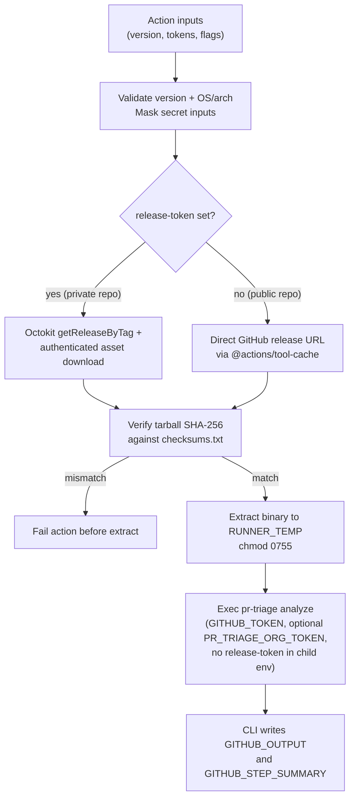
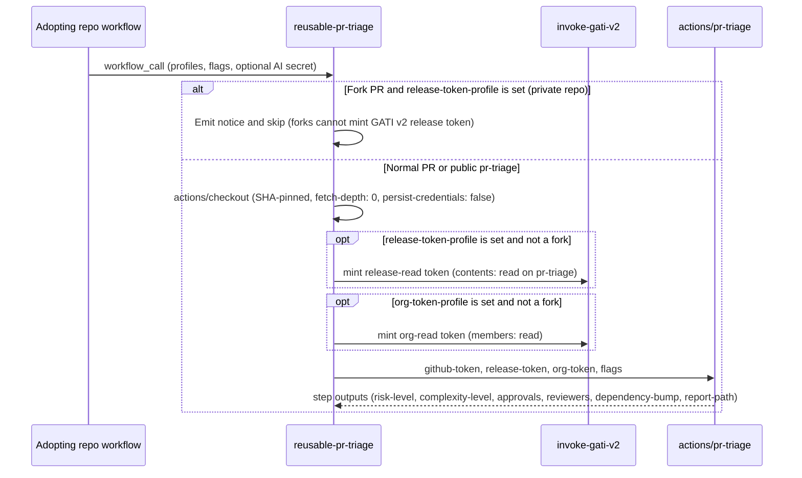

# Design: Add reusable pr-triage action and workflow

## Context

This monorepo (`smartcontractkit/.github`) hosts shared GitHub Actions under
`actions/<name>/` and reusable workflow sources under `workflows/<name>/`,
versioned independently with changesets (`<name>/vX.Y.Z` and mutable `<name>/vX`
tags). Two existing packages establish the exact conventions for this change:

- **`actions/ci-grafana-alert-test`** — a `node24` TypeScript action built with
  `@nx/esbuild:esbuild` into a committed `dist/index.js`, tested with `vitest`,
  that downloads a pinned prebuilt Go CLI tarball from GitHub Releases and
  executes it.
- **`workflows/reusable-codeowners-review-analysis`** — a `workflow_call`
  workflow source under `workflows/<name>/<name>.yml`, synced to
  `.github/workflows/<name>.yml` via `pnpm workflows:fix` (enforced by lefthook
  and `pnpm workflows:check`), that mints scoped GitHub tokens and invokes a
  local action.

`smartcontractkit/pr-triage` already satisfies the CLI half of this contract:

- Publishes `pr-triage_<ver>_linux_{amd64,arm64}.tar.gz` and
  `pr-triage_<ver>_checksums.txt` on every semver release tag (`vX.Y.Z`).
- Runs natively in GitHub Actions (`GITHUB_ACTIONS=true`), reading
  `GITHUB_EVENT_PATH`, wrapping stdout/stderr in `::stop-commands::` envelopes,
  writing `GITHUB_STEP_SUMMARY` and `GITHUB_OUTPUT` (`risk-level`,
  `complexity-level`, `approvals`, `reviewers`, `dependency-bump`,
  `report-path`), and skipping writes on fork PRs.
- Supports `PR_TRIAGE_ORG_TOKEN` for organization membership reads
  (`GET /orgs/{org}/members`) while keeping all pull request reads/writes on
  `GITHUB_TOKEN`.

This repo also enforces two operational constraints (`AGENTS.md`):

- Prefer TypeScript over bash; pin third-party actions to full commit SHAs; pass
  `${{ }}` values through `env:`.
- Keep PRs under 400 added lines of authored code and config (excluding `dist/`,
  lockfiles, and tests).

## Approach

### 1. Reusable Action: `actions/pr-triage`

A thin `node24` TypeScript action that downloads a pinned `pr-triage` Linux
release tarball, verifies its SHA-256 digest against the release's
`checksums.txt`, extracts the binary into `RUNNER_TEMP`, and executes
`pr-triage analyze`.



#### Module layout

- `actions/pr-triage/src/index.ts` — entry point calling `run()` and reporting
  errors via `core.setFailed`.
- `actions/pr-triage/src/release.ts` — pure helpers:
  - `validateVersion(version: string): string` — enforces semver tag shape
    `^v(0|[1-9][0-9]*)\.(0|[1-9][0-9]*)\.(0|[1-9][0-9]*)(-[0-9A-Za-z.-]+)?$`.
  - `resolveAssets(version: string, runnerOs: string, runnerArch: string): ReleaseAssets`
    — accepts `Linux` only and maps `X64` -> `amd64`, `ARM64` -> `arm64`.
    Returns archive filename `pr-triage_<bareVer>_linux_<arch>.tar.gz`, checksum
    filename `pr-triage_<bareVer>_checksums.txt`, and public download URLs.
  - `parseChecksum(checksumsText: string, filename: string): string` — parses
    `<64-hex>  <filename>` lines and throws if missing or malformed.
  - `verifySha256(filePath: string, expectedHex: string): void` — computes
    SHA-256 via `node:crypto` and throws with expected vs actual on mismatch.
- `actions/pr-triage/src/download.ts` — fetches archive + checksums and installs
  the binary:
  - When `releaseToken` is non-empty: uses
    `@actions/github.getOctokit(releaseToken)` to call
    `repos.getReleaseByTag({ owner: "smartcontractkit", repo: "pr-triage", tag: version })`,
    locates both assets by exact filename, and downloads each via
    `tc.downloadTool(asset.url, undefined, \`Bearer ${releaseToken}\`, { accept:
    "application/octet-stream" })`.
  - When `releaseToken` is empty: downloads both via
    `tc.downloadTool(publicUrl)`.
  - Calls `verifySha256` before `tc.extractTar`, verifies the extracted
    `pr-triage` binary exists, and `chmodSync(binPath, 0o755)`.
- `actions/pr-triage/src/run.ts` — orchestrates inputs, secret masking
  (`core.setSecret` on `github-token`, `release-token`, `org-token`,
  `ai-api-key`), binary installation, CLI argument building, and `@actions/exec`
  invocation.

```ts
// actions/pr-triage/src/release.ts (sketch)
export type ReleaseArch = "amd64" | "arm64";

export interface ReleaseAssets {
  tag: string;
  arch: ReleaseArch;
  archiveName: string;
  checksumsName: string;
  archiveUrl: string;
  checksumsUrl: string;
}
```

#### Action inputs and outputs (`actions/pr-triage/action.yml`)

- **Inputs:**
  - `version` (optional; defaults to pinned `RELEASE_VERSION` constant in
    `run.ts`)
  - `github-token` (optional; default `${{ github.token }}`)
  - `release-token` (optional; default `""` — required while
    `smartcontractkit/pr-triage` is private; omit once public)
  - `org-token` (optional; default `""` — forwarded as `PR_TRIAGE_ORG_TOKEN`)
  - `dry-run` (optional; default `"false"`)
  - `skip-reviewer-requests` (optional; default `"false"`)
  - `allow-non-org-reviewers` (optional; default `"false"`)
  - `verbose` (optional; default `"false"`)
  - `no-ai` (optional; default `"false"`)
  - `ai-api-key` (optional; default `""` — forwarded as `PR_TRIAGE_AI_API_KEY`)
  - `ai-base-url` (optional; default `""` — forwarded as
    `PR_TRIAGE_AI_BASE_URL`)
  - `log-level` (optional; default `""` — forwarded as `--log-level`)
- **Outputs:** `risk-level`, `complexity-level`, `approvals`, `reviewers`,
  `dependency-bump`, `report-path` (written directly to `GITHUB_OUTPUT` by
  `pr-triage analyze`).
- **Child environment isolation:** Construct the child `env` from `process.env`,
  explicitly set `GITHUB_TOKEN`, set or delete `PR_TRIAGE_ORG_TOKEN`,
  `PR_TRIAGE_AI_API_KEY`, and `PR_TRIAGE_AI_BASE_URL`, and never place
  `release-token` in the child environment. Also delete the runner's
  `INPUT_RELEASE-TOKEN` copy, because GitHub exports every JavaScript-action
  input as an environment variable.

### 2. Reusable Workflow: `workflows/reusable-pr-triage`

A `workflow_call` workflow at
`workflows/reusable-pr-triage/reusable-pr-triage.yml` (synced to
`.github/workflows/reusable-pr-triage.yml` via `pnpm workflows:fix`).



- **Job permissions:**
  - `contents: read` (checkout, commit attribution, rulesets/branch protection
    reads)
  - `pull-requests: write` (labels, reviewer requests, PR reads)
  - `issues: write` (label creation, report comment upsert/cleanup)
  - `id-token: write` (OIDC token for `invoke-gati-v2`)
- **GATI v2 wiring:** Calls
  `smartcontractkit/.github/actions/invoke-gati-v2@invoke-gati-v2/v1` directly
  (no AWS v1 fallback needed), which automatically revokes each minted
  installation token in its `post` step.
  - `release-token-profile` (string, optional, default `""`): GATI v2 profile
    with `contents: read` on `smartcontractkit/pr-triage`. Once `pr-triage` is
    public, callers (or the workflow default) leave this empty and the step is
    skipped.
  - `org-token-profile` (string, optional, default `""`): GATI v2 profile with
    organization `members: read`.
- **Fork-PR behavior:**
  - Fork detection uses
    `github.event.pull_request.head.repo.full_name != github.repository` (also
    true when `head.repo` is `null` for a deleted fork).
  - While `release-token-profile` is set, fork PRs cannot mint a GATI v2 token
    to download the private binary, so the job skips cleanly with a notice
    instead of failing.
  - Once `pr-triage` is public (`release-token-profile` empty), fork PRs skip
    only org-token minting and pass `allow-non-org-reviewers: true` so analysis,
    step summary, and outputs still succeed.
- **Calling `actions/pr-triage` from the reusable workflow:** References
  `smartcontractkit/.github/actions/pr-triage@pr-triage/v0` (or the initial
  published major tag after Phase 1 releases), matching how
  `workflows/reusable-codeowners-review-analysis` references
  `actions/codeowners-review-analysis`.

### Trade-offs and rejected options

- **`invoke-gati-v2` directly vs. `setup-github-token`:** Chose `invoke-gati-v2`
  directly because `pr-triage` has no GATI v1 legacy callers and does not need
  `set-git-config`, avoiding an extra composite layer and AWS-role inputs.
- **SHA-256 verification against `checksums.txt` vs. requiring `cosign` /
  `gh attestation verify` inside the action:** Verifying SHA-256 in pure Node
  (`node:crypto`) adds zero external binary dependencies and works identically
  for private and public releases; cosign/attestation verification can be
  layered on later without breaking action inputs.
- **Not caching the binary across jobs in `@actions/tool-cache`:** GitHub-hosted
  runners are ephemeral, and extracting into a per-step `RUNNER_TEMP` directory
  avoids cross-job state on self-hosted runners while keeping download time
  under a second.

## Verification

- Standard checks: `pnpm lint:affected`, `pnpm test:affected`,
  `pnpm build:affected`, `pnpm workflows:check`, `pnpm prettier:check`, and
  `actionlint` (via lefthook).
- **Unit tests (`vitest`) for `actions/pr-triage`:**
  - `release.test.ts`: valid/invalid semver tags, Linux `X64`/`ARM64` mapping,
    non-Linux (`macOS`, `Windows`) and unsupported arch rejection,
    `checksums.txt` parsing (valid, missing entry, malformed hash), and
    `verifySha256` match vs. mismatch.
  - `run.test.ts`: authenticated download path (Octokit + bearer header +
    `application/octet-stream`) vs. public URL path when `release-token` is
    empty; secret masking of all token inputs; child `env` includes
    `GITHUB_TOKEN` and optional `PR_TRIAGE_ORG_TOKEN` / AI vars and excludes
    `release-token`; flag forwarding (`--dry-run`, `--skip-reviewer-requests`,
    `--allow-non-org-reviewers`, `--verbose`, `--no-ai`, `--log-level`);
    non-zero CLI exit code propagates as action failure.
- **Workflow & sync verification:**
  - `pnpm workflows:check` confirms
    `workflows/reusable-pr-triage/reusable-pr-triage.yml` and
    `.github/workflows/reusable-pr-triage.yml` are identical.
  - `actionlint` passes on the reusable workflow with no expression or
    script-injection warnings.
  - PR size check: the first implementation of `actions/pr-triage` totals about
    713 authored non-test, non-`dist/` lines (93 `action.yml`, 86 `README.md`,
    106 config, 428 TypeScript), which exceeds the 400-line limit in
    `AGENTS.md`. Land Phase 1 as a stack: scaffold plus `release.ts` and
    `download.ts` first, then `run.ts`, `index.ts`, the action metadata, and the
    README. Phase 2 is a separate layer on top.

## Risks

- **Action tag ordering when landing Phase 1 and Phase 2:**
  `workflows/reusable-pr-triage` references
  `smartcontractkit/.github/actions/pr-triage@pr-triage/v0`. That tag does not
  exist until Phase 1 merges and changesets tags it. Mitigated by landing Phase
  1 first (or pinning to the release tag once changesets creates it) before
  adopting repos call the reusable workflow.
- **Private release download failure on wrong GATI v2 profile:** If
  `release-token-profile` lacks `contents: read` on
  `smartcontractkit/pr-triage`, `repos.getReleaseByTag` returns `404`. Mitigated
  by wrapping `404`/`403` errors in `download.ts` with a clear message naming
  the repo, tag, and required `contents: read` permission.
- **Unverified or truncated tarball:** A corrupted download or tampered asset
  could fail extraction or run a bad binary. Mitigated by verifying SHA-256
  against `checksums.txt` before `tc.extractTar`.
- **Leaking `release-token` to analyzed repo code or logs:** Mitigated by
  calling `core.setSecret(releaseToken)` immediately and excluding
  `release-token` from the `pr-triage` child process environment.

## TODO

Effort: medium (builds a new `node24` TypeScript action with private/public
release download and SHA-256 verification, plus a synced reusable workflow with
GATI v2 and fork-PR handling)

### Phase 1: Add `actions/pr-triage` TypeScript action

- [x] Scaffold `actions/pr-triage` (`action.yml`, `package.json`,
      `project.json`, `tsconfig.json`, `tsconfig.spec.json`, `CHANGELOG.md`,
      `README.md`) and implement `src/release.ts`, `src/download.ts`,
      `src/run.ts`, and `src/index.ts` with unit tests in
      `src/__tests__/release.test.ts` and `src/__tests__/run.test.ts`.
- [x] Build committed `actions/pr-triage/dist/index.js` via
      `pnpm build:affected`, add a minor changeset in `.changeset/`, and verify
      with `pnpm lint:affected`, `pnpm test:affected`, and
      `pnpm prettier:check`.

### Phase 2: Add `workflows/reusable-pr-triage` reusable workflow

Effort: easy (thin `workflow_call` wrapper following
`workflows/reusable-codeowners-review-analysis` conventions and synced via
`pnpm workflows:fix`)

- [x] Add `workflows/reusable-pr-triage/` (`reusable-pr-triage.yml`,
      `package.json`, `CHANGELOG.md`, `README.md`) with SHA-pinned
      `actions/checkout` (`fetch-depth: 0`), minimal permissions,
      `invoke-gati-v2` token minting, fork-PR handling, and `actions/pr-triage`
      invocation; sync `.github/workflows/reusable-pr-triage.yml` via
      `pnpm workflows:fix`.
- [ ] Add a minor changeset in `.changeset/` for `reusable-pr-triage` and verify
      with `pnpm workflows:check`, `actionlint`, and `pnpm prettier:check`.
