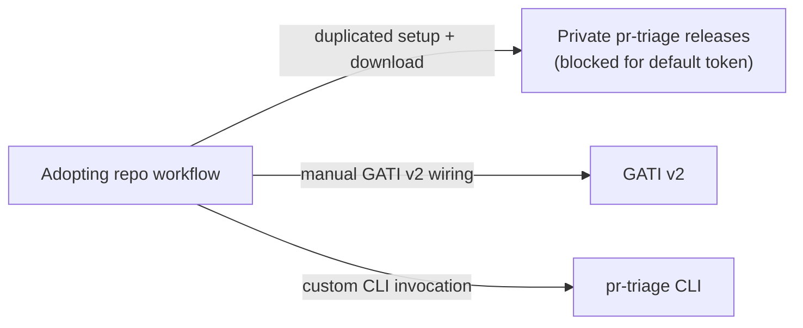
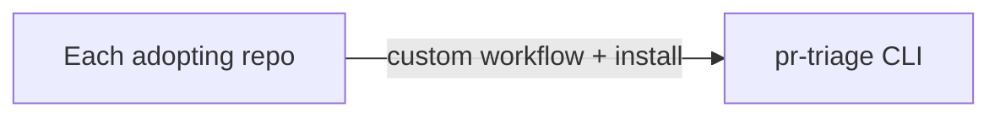
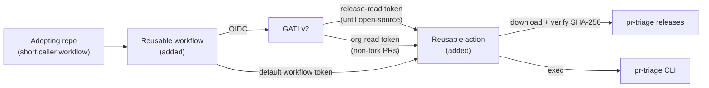

# Add reusable pr-triage action and workflow

## Context

`smartcontractkit/pr-triage` scores pull requests for risk and complexity,
recommends approvals, and requests reviewers who know the changed code. It
already publishes signed Linux release archives with SHA-256 checksums, runs
natively in GitHub Actions, and supports a separate org-read token so
organization membership lookups stay off the pull request write token.

Today there is no shared way to run it across the organization. Every adopting
repository would have to duplicate workflow boilerplate: full-history checkout,
minimal job permissions, binary download and checksum verification, and GATI v2
token minting for both private release downloads (until `pr-triage` is
open-sourced) and organization membership reads.

## Goals and non-goals

**Why now:** `pr-triage` now supports the least-privilege org-token split and is
ready for org-wide rollout. Putting the shared action and reusable workflow in
this monorepo gives repositories a short caller workflow today and lets us
remove the private-release token in one place when `pr-triage` becomes public.

**Goals:**

- Ship a thin TypeScript reusable action that downloads a pinned Linux
  `pr-triage` release archive, verifies its SHA-256 checksum, runs
  `pr-triage analyze`, and exposes its step outputs.
- Ship a thin reusable workflow that wraps the action with full-history
  checkout, minimal permissions, fork-PR handling, and GATI v2 token minting for
  private release downloads and organization membership reads.
- Keep pull request writes on the calling repository's default workflow token
  while passing the minted org-read token solely for membership checks.
- Make the transition to open-source `pr-triage` a single-place cleanup in the
  reusable workflow with no breaking changes for callers.

**Non-goals:**

- Supporting macOS or Windows runners in the initial action (only Linux `amd64`
  and `arm64` runners are targeted).
- Building `pr-triage` from source or packaging it as a Docker container action.
- Provisioning GATI v2 profiles themselves (profile names are passed as inputs
  with sensible defaults).
- Changing `pr-triage`'s scoring logic, policy format, or report layout.

## Decision

Add a TypeScript (`node24`) reusable action that downloads, checksum-verifies,
and runs a pinned `pr-triage` Linux release binary, plus a reusable workflow
that wires checkout, least-privilege permissions, and GATI v2 token minting on
top of it.

### Before

### After

- **Why a TypeScript binary-wrapper action beats a composite bash action or
  Docker action:** TypeScript matches this repository's action standard, makes
  release-API download, checksum verification, and flag mapping unit-testable
  with vitest, and starts in seconds without a container registry or Go/cgo
  toolchain.
- **Why pairing the action with a reusable workflow beats shipping an action
  alone:** Centralizing full-history checkout, GATI v2 token minting, and
  fork-PR handling keeps adopting workflows tiny and lets us drop the
  private-release token in one place once `pr-triage` is public.
- **Why `medium` effort fits:** The change spans a new TypeScript action with
  authenticated and public release download plus SHA-256 verification, a synced
  reusable workflow with GATI v2 and fork-PR edge cases, and nx/changeset/lint
  integration across both packages.
