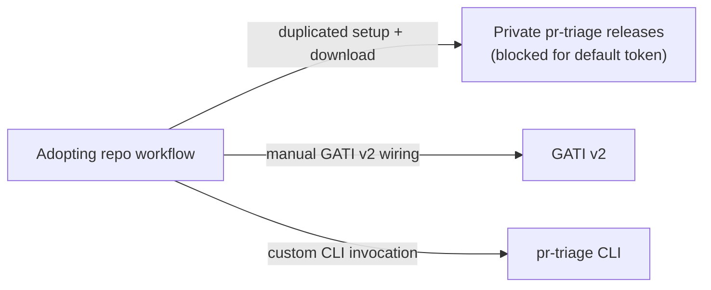
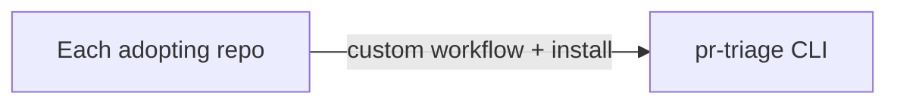
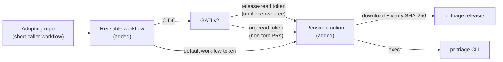

# Add reusable pr-triage action and workflow

## Context

`smartcontractkit/pr-triage` scores pull requests for risk and complexity,
recommends approvals, and requests reviewers who know the changed code. It
already publishes signed Linux release archives with SHA-256 checksums, runs
natively in GitHub Actions, and supports a separate org-read token so
organization membership lookups stay off the pull request write token.

Today there is no shared way to run it across the organization. Every adopting
repository would have to duplicate workflow boilerplate: full-history checkout,
minimal job permissions, binary download and checksum verification, and GATI v2
token minting for both private release downloads (until `pr-triage` is
open-sourced) and organization membership reads.

## Goals and non-goals

**Why now:** `pr-triage` now supports the least-privilege org-token split and is
ready for org-wide rollout. Putting the shared action and reusable workflow in
this monorepo gives repositories a short caller workflow today and lets us
remove the private-release token in one place when `pr-triage` becomes public.

**Goals:**

- Ship a thin TypeScript reusable action that downloads a pinned Linux
  `pr-triage` release archive, verifies its SHA-256 checksum, runs
  `pr-triage analyze`, and exposes its step outputs.
- Ship a thin reusable workflow that wraps the action with full-history
  checkout, minimal permissions, fork-PR handling, and GATI v2 token minting for
  private release downloads and organization membership reads.
- Keep pull request writes on the calling repository's default workflow token
  while passing the minted org-read token solely for membership checks.
- Make the transition to open-source `pr-triage` a single-place cleanup in the
  reusable workflow with no breaking changes for callers.

**Non-goals:**

- Supporting macOS or Windows runners in the initial action (only Linux `amd64`
  and `arm64` runners are targeted).
- Building `pr-triage` from source or packaging it as a Docker container action.
- Provisioning GATI v2 profiles themselves (profile names are passed as inputs
  with sensible defaults).
- Changing `pr-triage`'s scoring logic, policy format, or report layout.

## Decision

Add a TypeScript (`node24`) reusable action that downloads, checksum-verifies,
and runs a pinned `pr-triage` Linux release binary, plus a reusable workflow
that wires checkout, least-privilege permissions, and GATI v2 token minting on
top of it.

### Before

### After

- **Why a TypeScript binary-wrapper action beats a composite bash action or
  Docker action:** TypeScript matches this repository's action standard, makes
  release-API download, checksum verification, and flag mapping unit-testable
  with vitest, and starts in seconds without a container registry or Go/cgo
  toolchain.
- **Why pairing the action with a reusable workflow beats shipping an action
  alone:** Centralizing full-history checkout, GATI v2 token minting, and
  fork-PR handling keeps adopting workflows tiny and lets us drop the
  private-release token in one place once `pr-triage` is public.
- **Why `medium` effort fits:** The change spans a new TypeScript action with
  authenticated and public release download plus SHA-256 verification, a synced
  reusable workflow with GATI v2 and fork-PR edge cases, and nx/changeset/lint
  integration across both packages.

## Consequences

Adopting a repository now takes one caller workflow and two GATI v2 profile
names. Release download, SHA-256 verification, flag mapping, permissions, and
fork handling live in one place instead of being copied per repository. The pull
request write token never gains organization or release access: the release
token is dropped from the child environment (including the runner's
`INPUT_RELEASE-TOKEN` copy), so analyzed code cannot reach it.

What got harder:

- `actions/pr-triage` is roughly 713 authored non-test lines, so it has to land
  as a stack before the workflow layer.
- Verification depends on tooling the environment does not provide by default:
  the repo pins pnpm 10.6.5 and the shell's pnpm 12 refuses the workspace, so
  scripts run through `mise exec -- pnpm`; `actionlint` is not on `PATH`.
- The action has no `lint` target, so `pnpm lint:affected` does not check its
  TypeScript.
- The reusable workflow is correct only for `pull_request` events, because fork
  detection reads the pull request payload. A non-PR event looks like a fork.
- The action is Linux `amd64`/`arm64` only, and callers must check out with full
  history (the workflow does it for them).

What we would revisit: whether SHA-256 against `checksums.txt` is enough once
`pr-triage` publishes signed attestations, and whether the binary should be
cached instead of extracted into a per-step temp directory.

## Alternatives considered

- **Composite bash action instead of TypeScript.** Rejected because this repo
  standardizes on TypeScript actions, and the download, checksum, and flag code
  becomes unit-testable with vitest instead of shell. The cost is the committed
  `dist/` bundle that must be rebuilt on every source change.
- **Docker container action.** Rejected because it adds a container build and
  registry pull to every run, and still needs the same download logic. The
  TypeScript action starts in seconds and needs no toolchain in the container.
- **Ship the action without a reusable workflow.** Rejected because each adopter
  would repeat full-history checkout, permission scoping, GATI v2 minting, and
  fork handling, and clearing the private-release token would become a
  per-repository edit.
- **`setup-github-token` instead of `invoke-gati-v2` directly.** Rejected
  because `pr-triage` has no GATI v1 callers and needs no git-config setup;
  calling `invoke-gati-v2` skips a composite layer and AWS-role inputs.
- **`cosign` / `gh attestation verify` instead of SHA-256.** Rejected for now
  because pure `node:crypto` works for private and public releases with no extra
  binary. Attestation checking can be layered on without changing inputs.
- **Caching the downloaded binary in `@actions/tool-cache`.** Rejected because
  hosted runners are ephemeral and a per-step `RUNNER_TEMP` directory avoids
  cross-job state on self-hosted runners; download time is already under a
  second.
- **A skipped job with a notice for fork pull requests.** Rejected because a
  skipped job cannot run steps, so the notice lives in a separate `fork-skip`
  job instead.
- **Download-mode tests in their own file.** Rejected because the task named two
  test files; the authenticated-versus-public split is driven end to end through
  `run()`, which still covers both paths.

## Implementation notes

- The design said to keep `release-token` out of the child environment by
  deleting `PR_TRIAGE_RELEASE_TOKEN`. That was wrong for JavaScript actions:
  GitHub exports every input as `INPUT_<NAME>`, so `buildChildEnv` also deletes
  `INPUT_RELEASE-TOKEN`. Otherwise the token would still be visible to the
  analyzed repository.
- The pinned `RELEASE_VERSION` is `v0.1.0`, chosen because
  `smartcontractkit/pr-triage` has no published releases. It is unverified: a
  real run fails at download until a release ships under that tag, and a
  different tag means editing the constant in `src/run.ts` and rebuilding
  `dist/index.js`.
- While `smartcontractkit/pr-triage` is internal, every real run needs
  `release-token` with `contents: read` there. An empty token works only after
  the repository is public.
- The workflow cannot run until `pr-triage/v0` exists, which requires the action
  layer to merge and changesets to tag it.
- `nx affected` reports every project, so the `:affected` scripts run far more
  than the new packages. Build output outside `actions/pr-triage/dist/` was
  unchanged.
- Workflow YAML has no unit tests here; verification is `actionlint` plus
  `pnpm workflows:check`. Any edit to the reusable workflow source must be
  followed by `pnpm workflows:fix` so the synced copy in `.github/workflows/`
  matches.
- Clearing `release-token-profile` is the whole cleanup once `pr-triage` is
  public: the mint step is already conditional and the action falls back to
  public release URLs. Fork pull requests then run the analysis instead of
  skipping. They run in forced dry-run, because the fork token is read-only and
  cannot write labels, comments, or reviewer requests.

## Follow-ups

- Publish the first `smartcontractkit/pr-triage` release, confirm the tag
  matches `RELEASE_VERSION` in `actions/pr-triage/src/run.ts`, and update the
  constant plus `dist/index.js` if it does not.
- After release, exercise the reusable workflow in a repository whose GATI v2
  profiles are configured and confirm a real download, checksum, analysis, and
  fork skip.
- Once `smartcontractkit/pr-triage` is public, clear `release-token-profile` in
  the workflow defaults and docs, and remove the authenticated download path if
  no private caller remains.
- Add a `lint` target to `actions/pr-triage` if the repo's convention requires
  one, so `pnpm lint:affected` covers its TypeScript.
- Add CI coverage for workflow YAML (for example, run `actionlint` in CI)
  instead of relying on a locally installed binary.
